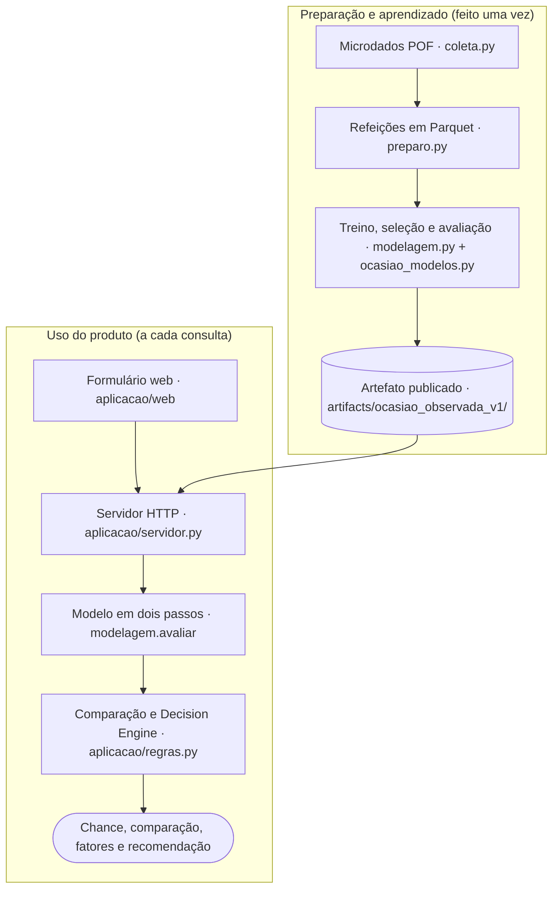

# Occasion Intelligence · Pizza e guaraná

**Em que ocasião vale testar um combo?** A ferramenta ajuda a equipe de marketing a escolher um contexto para um piloto. Informe o dia, o horário, a região e o público. A aplicação estima a chance de pizza e guaraná aparecerem juntos em uma refeição, compara o resultado com a média histórica e sugere uma ação.

[Abrir em outro computador](#instalacao-do-zero) · [Experimentar um cenário](#primeiro-uso) · [Resultados e testes](#dados-resultados-e-testes) · [Arquitetura](#fluxo-e-arquitetura) · [Repositório](#estrutura-do-repositorio) · [Documentação técnica](docs/documentacao.md)

**Vídeo demonstrativo:** publicação pendente.

<a id="instalacao-do-zero"></a>
## Abrir em outro computador

O modelo treinado acompanha o projeto. Para consultar a aplicação, basta instalar o ambiente Python com o [uv](https://docs.astral.sh/uv/). A primeira instalação precisa de internet para obter as dependências.

### 1. Obter o projeto

No PowerShell, abra a pasta onde deseja guardar o projeto e execute:

```powershell
git clone https://github.com/PedroMelo1910/Case-Ambev.git
cd Case-Ambev
```

Como alternativa, no GitHub escolha **Code → Download ZIP**, extraia o arquivo e abra o PowerShell na pasta extraída que contém `pyproject.toml`.

A pasta correta é a que contém o arquivo `pyproject.toml`. Confirme:

```powershell
Test-Path .\pyproject.toml   # deve responder True
```

### 2. Instalar o `uv`

Se `uv --version` não responder, instale pelo método oficial e confira:

```powershell
powershell -ExecutionPolicy ByPass -c "irm https://astral.sh/uv/install.ps1 | iex"
uv --version
```

No **Linux, WSL ou macOS** o instalador oficial é:

```bash
curl -LsSf https://astral.sh/uv/install.sh | sh
uv --version
```

### 3. Preparar o ambiente

Da pasta que contém `pyproject.toml` (a raiz do projeto):

```powershell
uv sync --locked
```

O comando cria o ambiente virtual, instala o Python 3.12 e as versões de `uv.lock`. É igual no Windows e no Linux/WSL/macOS.

### 4. Iniciar a aplicação

Entre em `src` e suba o servidor:

```powershell
cd src
uv run python -m aplicacao.servidor
```

O servidor verifica a integridade do modelo publicado ao iniciar. Quando ele imprimir `Ferramenta disponível em http://127.0.0.1:8000`, **abra `http://127.0.0.1:8000` no navegador**. Para usar outra porta: `uv run python -m aplicacao.servidor --porta 8001`.

### 5. Encerrar

No terminal em que o servidor está rodando, pressione **`Ctrl+C`**.

<a id="primeiro-uso"></a>
## Experimente dois cenários

1. Selecione **domingo → noite (19h–4h) → Sudeste → capital → público geral** e clique em **Avaliar ocasião**. A tela mostra **0,65%**, cerca de **10,3 vezes** a média de **0,063%** das refeições com comida. Período, dia e tipo de área aparecem entre os fatores. A ação sugerida é **testar um combo de pizza com guaraná neste contexto**.
2. Mantenha região, área e público. Troque para **terça-feira → tarde (15h–18h)** e avalie novamente. A estimativa para a ocasião é **0,021%**. A média geral continua em **0,063%**. Há poucos casos observados nesse dia e período para sustentar uma decisão de marketing, por isso a tela identifica a estimativa como exploratória e orienta a não priorizar.

A fonte é a Pesquisa de Orçamentos Familiares (POF) do IBGE. Ela registra os itens consumidos na mesma refeição. Para medir o efeito comercial de oferecer um combo, compare as vendas de um grupo que recebeu a oferta com as de um grupo de controle.

<a id="dados-resultados-e-testes"></a>
## Resultados e testes

O modelo combina duas regressões logísticas: chance de pizza na refeição × chance de guaraná quando há pizza. No teste reservado, os 20% de maior score incluíram **20 dos 27 casos**. A regra simples por dia e período teve captura semelhante. O ganho mais claro foi na **precisão média** (0,0037 frente a 0,0019). A principal fonte de ordenação foi a ocasião de pizza. Consulte os [resultados, intervalos e análise por componente](docs/documentacao.md#resultados).

Na raiz do projeto, rode `uv run pytest`. A suíte usa exemplos controlados e o modelo publicado. Um teste opcional depende de um registro externo indicado por `CASE_AMBEV_AUDITORIA_MANIFESTO`. O uso da aplicação e os testes do modelo publicado dispensam esse registro.

### Preparar os dados da pesquisa (opcional)

Para reconstruir as refeições e a análise exploratória em outra máquina, abra o PowerShell **na raiz do projeto**, reserve espaço fora do repositório para os dados do IBGE e execute:

```powershell
$env:CASE_AMBEV_RAW_ROOT = Join-Path $HOME "ambev-pof/brutos"
$env:CASE_AMBEV_PROCESSADO_ROOT = Join-Path $HOME "ambev-pof/processados"
cd src
uv run python -m coleta
uv run python -m preparo
uv run python -m preparo auditoria
uv run python -m modelagem eda
```

No Linux/WSL, defina essas mesmas variáveis com `export CASE_AMBEV_RAW_ROOT="$HOME/ambev-pof/brutos"` e `export CASE_AMBEV_PROCESSADO_ROOT="$HOME/ambev-pof/processados"`. A coleta confere as assinaturas dos arquivos do IBGE. A auditoria grava os totais por edição e a análise exploratória grava `eda.json`. As URLs, datas e informações de licença estão no [manifesto de fontes](configs/manifesto_fontes.json). A licença específica dos microdados permanece sem confirmação. O repositório distribui o modelo e os resultados agregados.

O protocolo preserva a escolha já avaliada. Para inspecionar a avaliação publicada, consulte [teste.json](artifacts/ocasiao_observada_v1/teste.json) e [temporal.json](artifacts/ocasiao_observada_v1/temporal.json). Para recalcular a importância dos campos a partir dos dados preparados, copie a pasta **inteira** `artifacts/ocasiao_observada_v1` para outro local e, dentro de `src`, use `uv run python -m modelagem explicar --saida "<pasta copiada>"`. A cópia fornece a especificação e as assinaturas necessárias. Os comandos de seleção e abertura do teste têm uma proteção contra repetir a escolha após observar seu resultado.

<a id="fluxo-e-arquitetura"></a>
## Arquitetura

A preparação gera o modelo e seus registros de avaliação. Na consulta, o servidor usa esse modelo para calcular a estimativa e as regras para indicar a ação.



<a id="estrutura-do-repositorio"></a>
## Estrutura do repositório

```text
Case-Ambev/
├── src/
│   ├── coleta.py             # baixa a POF, confere SHA-256 e lê os microdados de largura fixa
│   ├── preparo.py            # monta as refeições em Parquet, valida o contexto e audita as contagens
│   ├── modelagem.py          # seleção, teste reservado, avaliação temporal, explicação e inferência (avaliar)
│   ├── ocasiao_modelos.py    # candidatos (taxa, dia×período, logística, dois passos, boosting), métricas e dobras
│   └── aplicacao/
│       ├── servidor.py       # servidor HTTP local: /api/opcoes e /api/avaliar
│       ├── regras.py         # rótulos em linguagem comum, comparação com a média e Decision Engine
│       └── web/              # formulário e tela (HTML, CSS e JavaScript)
├── configs/                  # protocolo, dicionário de variáveis, crosswalk entre edições e manifesto de fontes
├── artifacts/
│   └── ocasiao_observada_v1/ # modelo publicado e resultados (resumo, teste, temporal, explicação)
├── data/                     # área local de trabalho para dados; microdados ficam fora da entrega
├── tests/                    # testes com dados sintéticos e com o artefato publicado
├── docs/                     # documentação técnica e figuras
├── pyproject.toml            # dependências e metadados do projeto
├── uv.lock                   # versões resolvidas
└── README.md
```

Projeto acadêmico do Inteli, sem vínculo oficial com a Ambev.
