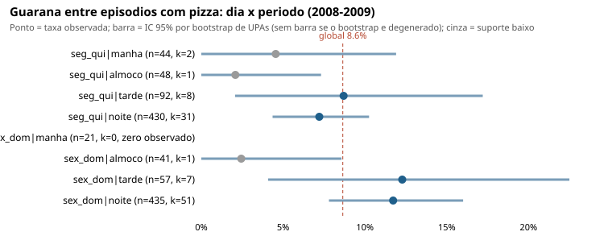
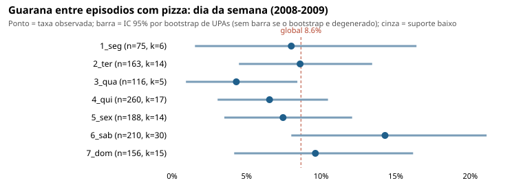
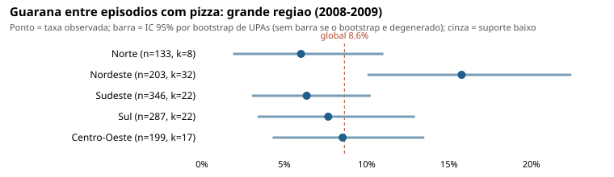
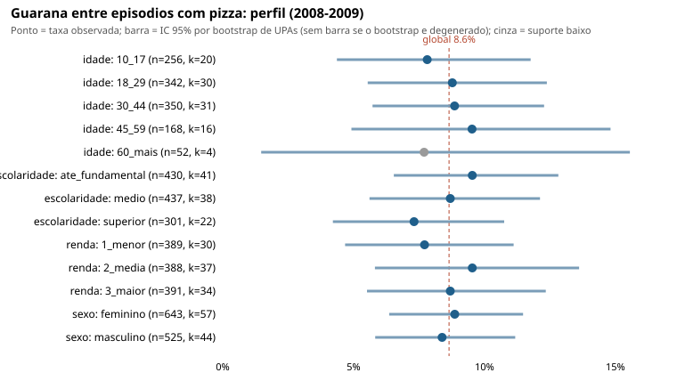

# Análise exploratória de desenvolvimento — POF 2008–2009

**Dados de desenvolvimento: POF 2008–2009.** Leitura principal **sem pesos**; n = episódios e k = episódios com guaraná. Os achados são **exploratórios** e não constituem seleção de variáveis por desempenho.

**Avaliação temporal:** houve exposição prévia a resultados agregados de 2017; esta análise usa somente 2008. Os detalhes e as restrições estão no [Data Card, item 6](DATA_CARD.md#6-estratégia-anti-leakage).

**Intervalos de 95%, sempre com o método nomeado.** As tabelas e figuras usam dois métodos, nunca misturados na mesma coluna:
- **IC boot.**: percentil do bootstrap de UPAs inteiras (5.000 réplicas, semente 20261113; limites = quantis 2,5% e 97,5% das réplicas, com interpolação linear, o "tipo 7"). Respeita a dependência entre episódios da mesma UPA, mas ignora o estrato e é condicional à presença do nível na reamostra. É o intervalo das figuras.
- **Wilson**: intervalo analítico que **supõe episódios independentes**. Aparece só na tabela 5.1, como comparação, e nos casos sem variação. Nenhum dos dois é limite garantido do outro.
- **Bootstrap degenerado.** Quando todos os episódios de um nível têm o mesmo resultado (k = 0 ou k = n), toda réplica repete esse valor: a variância estimada é zero e a dependência entre episódios não entra no intervalo. Nesses casos o IC boot. **não é publicado** ("degenerado") e as figuras mostram "zero observado" sem ponto nem barra. Ocorre em `sexta a domingo · manhã` (k = 0 em 21) e em 4 UFs.
- **Réplicas descartadas.** Uma réplica é descartada para um nível quando nenhuma UPA daquele nível é sorteada (taxa indefinida). Nos níveis com n ≥ 5 só três UFs perderam réplicas (UF 16 e 17: 1 de 5.000; UF 23: 5 de 5.000). O contraste de sexta a domingo não descartou nenhuma. Os registros de execução (fora do repositório) trazem a contagem por nível.
- **Estabilidade.** Repetindo as tabelas de período, dia da semana e região com cinco sementes, os limites do IC boot. variam até 0,6 ponto percentual (período), 0,45 (dia) e 0,29 (região); o contraste, 0,23. Números citados abaixo têm, portanto, incerteza de Monte Carlo da ordem de 0,3 a 0,6 ponto; casas decimais além da primeira não são informativas.

**Convenção de mascaramento (do projeto; sem garantia de anonimização).** Nas tabelas e figuras, níveis com 1 a 4 episódios saem com n, k e taxas suprimidos ("<5"). Níveis com n ≥ 5 saem completos, **inclusive com k de 1 a 4**. A convenção vale só para as tabelas e figuras geradas por código: a prosa deste documento cita contagens pequenas de estrutura (por exemplo 2 pessoas com 3 episódios). Os microdados do IBGE são públicos, o que não prova, por si, ausência de risco de identificação; nenhuma conferência de campos identificadores foi feita por este projeto.

Reprodução: `python -m occasion.eda_2008 --destino <pasta>`, com `CASE_AMBEV_SAIDA_ROOT` apontando para as entradas de desenvolvimento e `CASE_AMBEV_RAW_ROOT` para os dados públicos (necessário ao W1). Os cinco arquivos são validados pelos SHA-256 de `configs/entradas_2008.json` (Data Card, item 4). Duas execuções seguidas produziram arquivos idênticos: 17 tabelas, 4 figuras e o registro. CSVs completos e registros ficam externos ao repositório; as tabelas necessárias à leitura estão neste documento.

## 1. Integridade das junções

As cinco entradas de 2008 (`e2`, `features_comuns`, `identificadores`, `variaveis_nativas`, `matriz_logistica`) foram alinhadas por `episodio_id`. As matrizes não trazem esse identificador: o alinhamento delas é por posição, conferido contra os campos comuns.

| Checagem | Resultado |
|---|---|
| Mesmos 1.168 episódios, sem duplicados, na mesma ordem (por `episodio_id`) | passa |
| UPA e peso de `identificadores` = `e2` | 0 divergências em 1.168 |
| Dia da semana, região, área, idade e sexo das variáveis nativas = `features_comuns` | 0 divergências |
| Faixa de hora derivada da hora; matriz = nativas; sexta a domingo nativas = matriz | 0 divergências |
| Alvo de guaraná contido em "algum refrigerante" | 0 divergências |
| Peso constante dentro da pessoa | 0 pessoas com mais de um peso |
| Valores desconhecidos nas 28 colunas; renda inválida | 0; 1.168 rendas válidas |

As taxas são 7,9927% com W1, 8,011% com o peso integral da pessoa (W0) e 8,647% sem pesos.

## 2. Contagens e dependência entre episódios

| Unidade | Contagem | Observação |
|---|---|---|
| Episódios (positivos) | 1.168 (101) | |
| Pessoas | 1.106 | 1.046 com 1 episódio, 58 com 2, 2 com 3 |
| Unidades de consumo e domicílios | 715 e 715 | uma unidade de consumo com pizza por domicílio |
| UPAs | 644 | 351 com 1 episódio; 817 episódios em UPAs com 2 ou mais |
| Estratos (UF × estrato) | 293 | 144 com uma única UPA |
| UFs | 27 | |

- **752 dos 1.168 episódios (64%)** estão em domicílios com 2 ou mais episódios (299 domicílios).
- Os 101 positivos estão em **75 domicílios e 70 UPAs**. Em 17 domicílios há 2 positivos, em 3 há 3 e em 1 há 4; 47 positivos estão em domicílios com 2 ou mais positivos. Eles **não são 101 observações independentes**.
- Variáveis de domicílio (moradores, presenças, renda) são constantes entre os episódios do mesmo domicílio: 0 domicílios com valores diferentes.

## 3. Distribuição das variáveis, ausências, extremos e categorias raras

**Ausências.** Nenhuma das 28 colunas tem valor desconhecido; todas as 1.168 rendas são válidas.

**Extremos.**

| Variável | Resumo |
|---|---|
| Renda per capita (R$ de jan/2009) | mín. 52; p1 100; mediana 885; p99 7.554; máx. 26.700. 9 episódios acima de 10 medianas; 12 fora de 1,5 IQR no log |
| Idade (anos) | 10 a 94; mediana 29; p95 58 |
| Moradores na unidade de consumo | 1 a 11; 3 e 4 moradores são os mais comuns (338 e 325); 4 episódios com 9 ou mais |
| Peso da pessoa | p1 349; mediana 3.572; p99 33.901; máx. 60.533; 2 episódios com peso 1,0 |
| Hora | 2 episódios entre 0 h e 4 h (entram na faixa noite) |

**Distribuição e suporte.** Faixa de hora: noite 865 (74,1%), tarde 149 (12,8%), almoço 89 (7,6%), manhã 65 (5,6%). Sexta a domingo: 554 (47,4%). Domingo tem 156 episódios (13,4%).

**Categorias raras** (menos de 30 episódios ou menos de 5 positivos; só leitura descritiva): manhã e almoço (k = 2 cada); 60 anos ou mais (n = 52, k = 4); moradores = 1 (n = 41, k = 2); 4 combinações de dia × faixa de hora (manhã e almoço, nos dois tipos de dia), entre elas `sex_dom|manhã` (n = 21, k = 0); 18 das 27 UFs (nenhuma UF chega a 30 positivos: o maior é k = 11); No total, 30 linhas de tabela têm suporte baixo, contando 4 níveis vazios (`desconhecida` e `sem_renda`). A hora isolada (0 a 23 h) não é mais tabulada: níveis com 1 episódio seriam suprimidos e a soma pelo total os revelaria.

## 4. Distribuição do alvo

| Medida | k / n | Taxa |
|---|---|---|
| Guaraná entre episódios com pizza | 101 / 1.168 | 8,65% |
| Algum refrigerante entre episódios com pizza | 655 / 1.168 | 56,1% |
| Guaraná entre episódios com refrigerante | 101 / 655 | 15,4% |

O alvo é raro (cerca de 1 em 12). Como 132 dos 655 episódios com refrigerante são "não especificado", a taxa identificada pode subestimar o guaraná consumido.

## 5. Guaraná entre episódios com pizza, por contexto

Todas as taxas são **sem peso**. "IC boot." é o bootstrap de UPAs; "Wilson", onde aparece, supõe independência; "W1" é a taxa ponderada (item 6), sem intervalo. Taxas de grupos com k < 5 são só descrição.

### 5.1 Período

| Nível | n | k | Taxa (%) | IC boot. (%) | Wilson (%) | W1 (%) | Suporte |
|---|---|---|---|---|---|---|---|
| Segunda a quinta | 614 | 42 | 6,8 | 4,5 a 9,4 | 5,1 a 9,1 | 6,4 | ok |
| Sexta a domingo | 554 | 59 | 10,7 | 7,3 a 14,2 | 8,3 a 13,5 | 9,4 | ok |
| Manhã | 65 | 2 | 3,1 | 0,0 a 8,2 | 0,8 a 10,5 | 4,8 | baixo |
| Almoço | 89 | 2 | 2,2 | 0,0 a 6,0 | 0,6 a 7,8 | 1,8 | baixo |
| Tarde | 149 | 15 | 10,1 | 4,7 a 16,3 | 6,2 a 15,9 | 9,7 | ok |
| Noite | 865 | 82 | 9,5 | 6,9 a 12,1 | 7,7 a 11,6 | 8,7 | ok |
| Segunda a quinta · manhã | 44 | 2 | 4,5 | 0,0 a 11,9 | 1,3 a 15,1 | 6,0 | baixo |
| Segunda a quinta · almoço | 48 | 1 | 2,1 | 0,0 a 7,3 | 0,4 a 10,9 | 2,3 | baixo |
| Segunda a quinta · tarde | 92 | 8 | 8,7 | 2,1 a 17,2 | 4,5 a 16,2 | 5,9 | ok |
| Segunda a quinta · noite | 430 | 31 | 7,2 | 4,4 a 10,3 | 5,1 a 10,1 | 7,2 | ok |
| Sexta a domingo · manhã | 21 | 0 | 0,0 | — (degenerado) | 0,0 a 15,5 | 0,0 | baixo |
| Sexta a domingo · almoço | 41 | 1 | 2,4 | 0,0 a 8,6 | 0,4 a 12,6 | 1,2 | baixo |
| Sexta a domingo · tarde | 57 | 7 | 12,3 | 4,1 a 22,5 | 6,1 a 23,2 | 17,4 | ok |
| Sexta a domingo · noite | 435 | 51 | 11,7 | 7,8 a 16,0 | 9,0 a 15,1 | 9,8 | ok |

- **Comparação exploratória.** Sexta a domingo menos segunda a quinta = **+3,8 pontos percentuais**, IC boot. de **−0,2 a +8,1**, com 5.000 réplicas. A escolha do contraste ocorreu após a consulta às taxas por dia. O intervalo inclui zero e também comporta diferenças de alguns pontos; a estimativa não comprova a diferença entre os grupos. A avaliação temporal preserva a ressalva de exposição prévia descrita no Data Card.
- Manhã e almoço têm 4 positivos em 154 episódios (2,6%), com k = 2 em cada: a amostra não permite afirmar que a taxa seja baixa nem que seja zero.
- **Zero observado.** `sexta a domingo · manhã` tem **0 positivos em 21 episódios** (19 UPAs). O bootstrap é degenerado (acima) e não gera intervalo. Wilson dá 0,0 a 15,5%, supondo independência. O método exato de Clopper-Pearson sobre os mesmos 21 episódios dá limite superior de 16,1%, e tratando as 19 UPAs como unidades, 17,7%. Os métodos diferem e nenhum é intervalo garantido para observações agrupadas: o zero observado é compatível com taxas de alguns pontos acima de 15%, conforme o método, e não é probabilidade zero.

### 5.2 Dia da semana

| Dia | n | k | Taxa (%) | IC boot. (%) | W1 (%) |
|---|---|---|---|---|---|
| Segunda | 75 | 6 | 8,0 | 1,5 a 16,4 | 5,4 |
| Terça | 163 | 14 | 8,6 | 4,5 a 13,4 | 6,7 |
| Quarta | 116 | 5 | 4,3 | 0,9 a 8,4 | 3,5 |
| Quinta | 260 | 17 | 6,5 | 3,1 a 10,5 | 8,3 |
| Sexta | 188 | 14 | 7,4 | 3,5 a 12,1 | 4,0 |
| Sábado | 210 | 30 | 14,3 | 8,0 a 21,1 | 15,8 |
| Domingo | 156 | 15 | 9,6 | 4,2 a 16,2 | 7,5 |

O sábado tem a maior taxa observada (14,3%) e 30 dos 59 positivos de sexta a domingo. As comparações entre dias não foram testadas diretamente, e sobreposição de intervalos não prova igualdade nem diferença (é um critério conservador): a amostra não permite dizer que a sexta difere dos dias úteis nem descartar diferenças de alguns pontos. Sete comparações olhadas depois dos dados: **exploratório**.

### 5.3 Região

| Região | n | k | Taxa (%) | IC boot. (%) | W1 (%) |
|---|---|---|---|---|---|
| Norte | 133 | 8 | 6,0 | 1,9 a 11,0 | 8,3 |
| Nordeste | 203 | 32 | 15,8 | 10,1 a 22,4 | 20,8 |
| Sudeste | 346 | 22 | 6,4 | 3,0 a 10,2 | 4,9 |
| Sul | 287 | 22 | 7,7 | 3,4 a 12,9 | 9,3 |
| Centro-Oeste | 199 | 17 | 8,5 | 4,3 a 13,5 | 6,7 |

O Nordeste concentra 32 dos 101 positivos (32%) e tem a maior taxa nas duas leituras. A diferença não depende de uma UF só: retirando, uma de cada vez, as nove UFs nordestinas, a taxa do Nordeste fica entre 14,0% e 17,1%, acima das demais regiões (6,0% a 8,5%; 69 de 965, ou 7,2%, juntas). Os 32 positivos estão em 24 UPAs, com no máximo 2 por UPA; nas UFs com pelo menos 5 positivos aparecem 9/44 (BA), 7/25 (PE) e 6/36 (MA). Ainda assim é um achado olhado depois dos dados, entre cinco regiões e com UPAs agrupadas: hipótese para a validação por região, não regra.

### 5.4 Perfil

| Característica | n | k | Taxa (%) | IC boot. (%) | W1 (%) |
|---|---|---|---|---|---|
| Capital / urbano fora da capital / rural | 377 / 671 / 120 | 35 / 56 / 10 | 9,3 / 8,3 / 8,3 | 5,7–13,5 / 5,8–11,2 / 2,0–15,8 | 8,2 / 7,8 / 7,5 |
| Feminino / masculino | 643 / 525 | 57 / 44 | 8,9 / 8,4 | 6,4–11,5 / 5,8–11,2 | 8,2 / 7,8 |
| 10–17 anos | 256 | 20 | 7,8 | 4,4–11,8 | 11,0 |
| 18–29 anos | 342 | 30 | 8,8 | 5,5–12,4 | 5,1 |
| 30–44 anos | 350 | 31 | 8,9 | 5,7–12,3 | 11,4 |
| 45–59 anos | 168 | 16 | 9,5 | 4,9–14,8 | 5,2 |
| 60 anos ou mais | 52 | 4 | 7,7 | 1,5–15,6 | 3,8 |
| Até fundamental / médio / superior | 430 / 437 / 301 | 41 / 38 / 22 | 9,5 / 8,7 / 7,3 | 6,5–12,8 / 5,6–12,1 / 4,2–10,8 | 11,0 / 7,8 / 4,6 |
| Renda per capita: menor / média / maior tercil | 389 / 388 / 391 | 30 / 37 / 34 | 7,7 / 9,5 / 8,7 | 4,7–11,1 / 5,8–13,6 / 5,5–12,3 | 10,3 / 8,2 / 5,9 |
| Moradores: 1 / 2 / 3 / 4 / 5+ | 41 / 202 / 338 / 325 / 262 | 2 / 19 / 33 / 18 / 29 | 4,9 / 9,4 / 9,8 / 5,5 / 11,1 | 0,0–12,5 / 4,9–14,7 / 5,9–14,0 / 3,0–8,5 / 6,1–16,8 | 2,9 / 4,4 / 9,9 / 4,8 / 14,1 |
| Criança 0–11 no domicílio: sem / com | 667 / 501 | 53 / 48 | 7,9 / 9,6 | 5,4–10,7 / 6,3–13,0 | 7,1 / 9,4 |
| Adolescente 12–17 no domicílio: sem / com | 717 / 451 | 58 / 43 | 8,1 / 9,5 | 5,8–10,6 / 5,9–13,6 | 5,8 / 11,2 |
| Idoso 60+ no domicílio: sem / com | 977 / 191 | 87 / 14 | 8,9 / 7,3 | 6,6–11,3 / 3,0–12,2 | 8,6 / 5,0 |

Sem pesos, sexo, área, faixa etária e renda ficam entre 7,7% e 9,5%, com intervalos largos que se cruzam. Isso mostra que a amostra não revela diferença nítida entre esses grupos, mas não descarta diferenças de alguns pontos, e a sobreposição de intervalos não é teste de igualdade. Escolaridade tem declive observado (9,5% → 7,3%), não testado. As taxas por número de moradores (4,9; 9,4; 9,8; 5,5; 11,1%) não seguem ordem monótona e não há explicação testada; com 1 morador, k = 2. **A renda não mostra gradiente na taxa de guaraná sem pesos**; isso não contradiz o TAPI, que fala de consumo de pizza e de associação por classe, outra quantidade. Com W1, renda e escolaridade passam a mostrar gradiente (item 6): as duas leituras discordam. Os tercis de renda foram calculados com todos os episódios de 2008 e são **só descritivos** (não entram no modelo).

## 6. Pesos: W1 como sensibilidade e suas limitações

- **O que é W1.** Peso da pessoa (`PESO_FINAL`, do IBGE) dividido pelo número de dias de registro da pessoa no arquivo de consumo (quadros 71 e 72 são o 1º e o 2º dia de coleta). É uma **ponderação derivada**, não um peso por dia fornecido pelo IBGE. 18 episódios são de pessoas com 1 dia de registro e 1.150 de pessoas com 2.
- **Leitura principal sem pesos.** A pergunta de comparação entre modelos é qual deles prevê melhor a condicional na amostra; o peso responde a outra e custa precisão.
- **Limitações.** O peso é calibrado por UF, sexo e idade, mas **não corrige a composição por dia da semana** (domingo é 13,4% dos episódios em 2008 e 32,2% em 2017) nem a diferença entre o 1º e o 2º dia. Os pesos são desiguais (p1 349, p99 33.901): estimativas por grupo pequeno oscilam muito, por exemplo a taxa por faixa etária vai de 3,8% a 11,4% com W1 contra 7,7% a 9,5% sem pesos. O bootstrap por UPA ignora o estrato; 144 dos 293 estratos têm uma só UPA, portanto os IC ponderados são aproximações. O IC ponderado não é mostrado onde o bootstrap é degenerado.
- **Sinais que mudam com W1:** o declive por escolaridade fica mais forte (11,0% → 4,6%) e o da renda aparece (10,3% → 5,9%), enquanto sem pesos a renda é plana. Essa diferença entre as duas leituras é um diagnóstico de que os pesos importam, não uma conclusão sobre renda.
- **Dia de coleta (diagnóstico do instrumento, fora do modelo).** 1º dia: 37 de 484 (7,6%); 2º dia: 64 de 684 (9,4%).
- **O que W1 estima.** A proporção de episódios com guaraná entre os com pizza num dia médio de registro, na população de pessoas; para as 18 pessoas com 1 só dia, supõe-se que esse dia represente os dois.
- **Não** se usa aproximação de Kish como tamanho de amostra de treinamento.

## 7. Redundâncias entre indicadores e variáveis

- **Colinearidade exata.** As 28 colunas incluem **5 conjuntos completos de indicadores** (hora, região, área, idade, escolaridade) que somam 1 em todos os 1.168 episódios: cada um é colinear com o intercepto (28 colunas, posto 24). Com penalização (ridge), a solução é única; sem penalização, a logística não seria identificada.
- **Interação.** `sexta_a_domingo_x_noite` é exatamente o produto de `sexta_a_domingo` por `hora_noite` (confirmado em 1.168 episódios) e tem correlação 0,81 com `sexta_a_domingo`. Ser produto de duas colunas **não** a torna combinação linear delas: ela acrescenta uma dimensão ao posto da matriz (posto 24 com a interação e 23 sem, nas 28 colunas e também com intercepto). Correlação alta não é dependência linear, e a interação não é redundante no sentido do posto.
- **Pares de colunas com correlação absoluta ≥ 0,5:** `sexta_a_domingo` × interação (0,81); `area_capital` × `area_urbano_nao_capital` (−0,80); `hora_tarde` × `hora_noite` (−0,65); `escolaridade_ate_fundamental` × `escolaridade_medio` (−0,59); `idade_10_17` × `presenca_adolescente_12_17` (0,53).
- **Associação entre variáveis nativas (V de Cramér ≥ 0,3, sem o alvo):** faixa etária × presença de adolescente (0,55), faixa etária × presença de idoso (0,49), moradores × presença de criança (0,45), faixa etária × escolaridade (0,38), moradores × presença de adolescente (0,38). A faixa etária do próprio episódio e a composição do domicílio contam parte da mesma informação.
- **Unidade de consumo = domicílio** na amostra: moradores, presenças e renda são constantes por domicílio e repetem o mesmo valor entre seus episódios.

## 8. Consequências para validação, interpretação e modelagem

**Validação.**
- Agrupar sempre por UPA (pessoa e domicílio ficam do mesmo lado). Com 101 positivos em 70 UPAs, cada dobra de 10 terá em média cerca de 10 positivos: estratificar e repetir a validação, e relatar a variação entre repetições.
- Deixar uma região fora é informativo mas frágil: Norte tem 8 positivos e Nordeste, 32. A avaliação por região deve mostrar n e k e não taxa onde k < 5.
- O IC por UPA ignora o estrato (144 dos 293 estratos têm uma só UPA) e é condicional à presença do nível; não é limite garantido para outros métodos de intervalo.
- Em 2017 o domingo pesa 32,2% dos episódios; qualquer diferença entre 2008 e 2017 mistura calendário, instrumento e tempo.

**Interpretação.**
- O score é a frequência histórica de guaraná em episódios com pizza de contextos parecidos em 2008–09; não é chance de pedir, nem preferência pela marca, nem efeito de ação.
- Taxas em grupos com k < 5 não devem virar recomendação; a classe `evidencia_insuficiente` do Decision Engine tem base empírica.
- Zero observado (por exemplo `sex_dom|manhã`) não é probabilidade zero.

**Modelagem (sem concluir sobre desempenho).**
- Os dados mostram heterogeneidade modesta no perfil e mais no calendário e na região; **isso não permite antecipar se um modelo superará o baseline por dia e período, nem que não funcionará**. Só a validação dirá.
- Os indicadores completos exigem tratamento explícito da colinearidade. A especificação inicial prevê logística com penalização ridge; intercepto e escala devem ser definidos antes do ajuste.
- A associação descritiva não demonstra a contribuição preditiva de um grupo de variáveis; essa contribuição exige comparação entre modelos em dados de validação.

