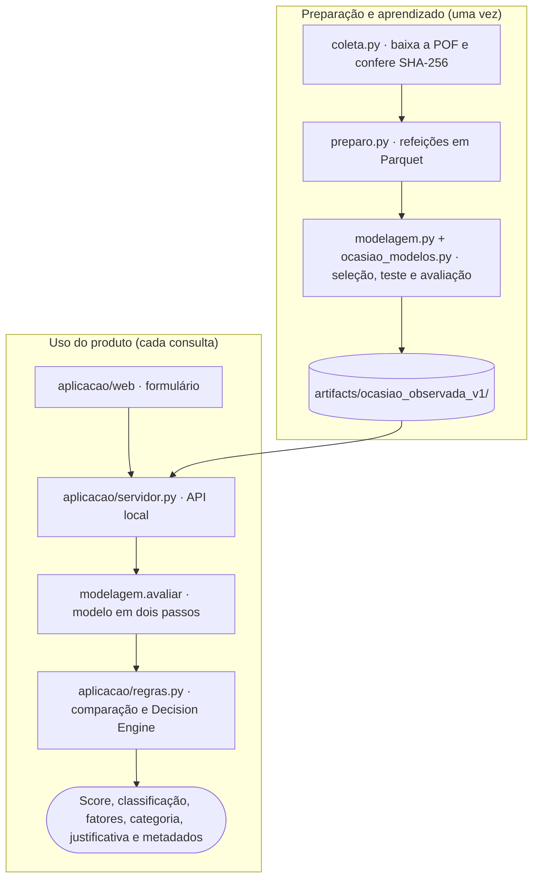

# Documentação técnica — Occasion Intelligence: Pizza e Guaraná

[Voltar ao README](../README.md)

Este documento descreve a construção e a avaliação do modelo que a aplicação usa. A [instalação, os comandos de reprodução e o mapa do repositório](../README.md) ficam no README. A especificação usada na escolha do modelo está no [protocolo](../configs/protocolo_v3_alvo_observado.json).

## Índice

1. [O que o modelo prevê](#o-que-preve)
2. [Arquitetura e responsabilidades](#arquitetura)
3. [Data Card](#data-card)
4. [Análise exploratória e modelagem](#eda-modelagem)
5. [Resultados que orientam a decisão](#resultados)
6. [Dificuldades e alcance da previsão](#dificuldades)
7. [O que foi investigado e ficou fora](#fora-do-modelo)
8. [Rastreabilidade e marcos de versão](#reproducao)

## 1. O que o modelo prevê

A pergunta de marketing é em quais ocasiões vale testar uma oferta conjunta. O modelo estima a probabilidade de pizza e guaraná aparecerem em uma refeição com comida. As regras usam essa estimativa para indicar uma ação. O efeito da oferta sobre vendas exige um piloto com grupo de controle.

A unidade, os códigos de alimentos e os denominadores estão no [Data Card](#data-card). A [avaliação](#resultados) compara o modelo à frequência por dia e período.

## 2. Arquitetura e responsabilidades

### Dois momentos, uma stack

O sistema separa o aprendizado, feito uma vez, do uso do produto, feito a cada consulta. Tudo roda localmente em Python; não há banco de dados, fila nem backend HTTP separado.

### Dos registros à refeição

`preparo.py` transforma os registros de consumo da POF em **refeições**: agrupa por pessoa × dia de registro × hora inteira (`V9015`), mantém apenas as refeições com ao menos um item de comida (pela classificação oficial da edição) e marca, em cada refeição, se há pizza, refrigerante, guaraná identificado e o sabor. As tabelas de escolhas saem em Parquet com um contrato (`*.contrato.json`) e passam por uma auditoria que reconstrói as contagens a partir dos registros brutos.

### Como o artefato é produzido e carregado

`modelagem.desenvolver` registra a especificação escolhida em `desenvolvimento.json`. A etapa `testar` ajusta essa especificação, avalia o conjunto reservado e grava o modelo, o resumo, as métricas e os metadados. As etapas `temporal` e `explicar` produzem os relatórios correspondentes. Na aplicação, `modelagem.carregar` compara as assinaturas do modelo e do resumo com as registradas em `meta.json` antes da primeira consulta.

### Campos que chegam à inferência

Na consulta, o contexto tem os campos que a equipe conhece no instante de previsão: `dia_semana`, `periodo` **ou** `hora`, `grande_regiao`, `area` e os três campos de público (`faixa_etaria`, `sexo`, `escolaridade`), cada um deles podendo ser `todos` (público geral). `preparo.preparar` valida e canoniza esse contexto. Quando a hora não é informada, o modelo pondera as horas do período pela frequência observada no treino; com público geral, usa a composição de público observada na região e no tipo de área.

### Da previsão à recomendação

`aplicacao/regras.py` recebe a estimativa do contexto, a média de referência e a faixa de incerteza (obtida com modelos reajustados em reamostras de UPAs) e decide uma **faixa de comparação** — acima da média, abaixo, sem diferença demonstrada ou evidência insuficiente. O *Decision Engine* aplica regras explícitas, em ordem, sobre essa faixa: contexto acima da média → **testar um combo neste contexto** (hipótese a testar com grupo de controle); diferença não demonstrada → sem destaque; abaixo da média → baixa prioridade; evidência insuficiente → não priorizar. As regras não estimam retorno, volume nem canal.

Quando o modelo consegue calcular a previsão, o percentual principal é a estimativa para a ocasião. Se os dados são insuficientes para comparar, a tela identifica a estimativa como exploratória, mostra a média geral à parte e mantém a orientação de não priorizar. As contagens ficam em “Como o modelo calculou a estimativa”. Se um filtro de público fica em aberto e a pesquisa não registra nenhuma refeição que combine os demais, a tela indica qual filtro ampliar para obter uma previsão.

### Escolha da stack

A stack segue a referência do TAPI e as necessidades desta aplicação: **DuckDB** lê os microdados de largura fixa e grava Parquet sem servidor de banco, adequado a uma base que cabe em arquivos locais; **scikit-learn** fornece a logística regularizada, a validação cruzada agrupada e as métricas de discriminação e calibração, suficientes para um alvo raro em que a calibração importa mais que capacidade bruta; a interface é um **servidor HTTP da biblioteca padrão** com HTML, CSS e JavaScript, sem framework, porque o produto é uma ferramenta local de consulta. As versões ficam fixadas em `uv.lock` e o ambiente é gerido pelo `uv`.

### Contrato da aplicação

O pedido de `POST /api/avaliar` contém a chave `contexto`. O servidor identifica a versão publicada em `GET /api/opcoes` e nos metadados da resposta. Como o canal comercial não é observado, ele não é solicitado no formulário nem usado para segmentar as métricas. No envelope de sucesso, os campos de `data` são: `occasion_score`, `classification`, `top_factors`, `recommendation_category`, `recommendation_reason` e `model_metadata` (versão, modelo, alvo, unidade, fonte, avaliação no teste, regra do Decision Engine, avisos e SHA-256), além da leitura em linguagem de marketing e do próximo passo.

## 3. Data Card

Este Data Card descreve o modelo **entregue**: alvo conjunto pizza + guaraná entre todas as refeições com comida, desenvolvimento e teste na POF 2017–2018, avaliação temporal com a POF 2008–2009. Todos os números vêm dos artefatos em `artifacts/ocasiao_observada_v1/` e das contagens verificadas em `data/processed/`.

### 3.1 Unidade de análise

A **refeição com comida**: uma pessoa, em um dia de registro, numa hora inteira, com pelo menos um item de comida (`pessoa × dia × hora`). Identificador `episodio_id`, único por edição. O instante de previsão é o planejamento da ação, antes da refeição: só entram campos conhecidos nesse momento. A hora é arredondada pelo IBGE; a edição não tem data de calendário, só dia da semana e hora.

### 3.2 Alvo (ground truth ou proxy)

`alvo = 1` quando a **mesma refeição** tem pizza (lista da edição) **e** um dos seis códigos de guaraná identificado (`8200301`, `8200302`, `8201601`, `8201602`, `8207401`, `8207402`); caso contrário, 0. O tipo de ativação nunca é o alvo.

É registro **autodeclarado de consumo**. Pedido, canal e marca não são observados. A classificação da POF não tem código de marca de guaraná. Pizza com refrigerante **sem sabor** (`8203501`) e sem guaraná identificado é tratada como guaraná não identificado (zero no alvo principal); o protocolo considera duas sensibilidades: excluir essas refeições ou contá-las como positivas.

**Atenção ao denominador.** Três medidas diferentes aparecem no projeto e respondem a perguntas distintas:

| Medida | Numerador / denominador | 2017 desenv. | 2008 (inteira) |
|---|---|---|---|
| **Pizza e guaraná entre todas as refeições com comida** (o **alvo do modelo**) | positivos / refeições com comida | 154 / 245.414 = **0,063%** | 101 / 253.935 = **0,040%** |
| Guaraná entre refeições **com pizza** (o segundo passo) | positivos / refeições com pizza | 154 / 1.340 = **11,5%** | 101 / 1.168 = **8,65%** |
| Pizza entre todas as refeições com comida (o primeiro passo) | refeições com pizza / refeições com comida | 1.340 / 245.414 = **0,55%** | 1.168 / 253.935 = **0,46%** |

O score da tela é a **primeira** medida: pizza e guaraná entre todas as refeições. Com o peso de expansão do IBGE (`PESO_FINAL`), a taxa conjunta do desenvolvimento sobe para 0,086%, cerca de um terço acima. Os números da tela são da amostra, sem peso, e servem para **comparar contextos**, não para dimensionar mercado.

### 3.3 Dicionário de variáveis

O modelo entregue usa apenas as variáveis comuns harmonizadas entre as duas edições, nos três blocos cumulativos do protocolo (B1 calendário, B2 território, B3 público). São esses os campos disponíveis no formulário. A coluna "No formulário" distingue o que o usuário informa (`sim`) do que entra só como grupo de análise (`não`).

| Variável | Descrição | Origem 2008–09 | Origem 2017–18 | Bloco | No formulário |
|---|---|---|---|---|---|
| `dia_semana` | dia da semana (1 = segunda … 7 = domingo) | `DIA_SEMANA` | `DIA_SEMANA` | B1 | sim |
| `periodo` | manhã (5–10h), almoço (11–14h), tarde (15–18h), noite (19–4h) | `V9015` | `V9015` | B1 | sim |
| `hora` | hora inteira 0–23 (alternativa ao período) | `V9015` | `V9015` | B1 | sim |
| `dia_semana × periodo` | interação dia × período (também é o baseline) | derivada | derivada | B1 | — |
| `grande_regiao` | grande região, a partir da UF | `COD_UF` | `UF` | B2 | sim |
| `area` | capital, urbano fora da capital ou rural | estrato + planilha | estrato + planilha | B2 | sim |
| `faixa_etaria` | 10–17, 18–29, 30–44, 45–59, 60+ | `IDADE_ANOS` | `V0403` | B3 | sim (ou `todos`) |
| `sexo` | feminino ou masculino | `V0405` | `V0404` | B3 | sim (ou `todos`) |
| `escolaridade` | até fundamental, médio ou superior | `NIVEL_INSTRUCAO_MORADOR` | `NIVEL_INSTRUCAO` | B3 | sim (ou `todos`) |
| `upa` | UPA da refeição | cadastro | cadastro | — | não (grupo da validação e do bootstrap) |
| `peso` | peso de expansão da pessoa | `PESO_FINAL` | `PESO_FINAL` | — | não (só taxa ponderada) |
| `local_v9018` | local da refeição | `V9018` | `V9018` | — | não (só diagnóstico de "em casa") |

**Campos disponíveis × campos que demonstraram importância.** Todos os campos acima marcados "sim" aparecem no formulário. A importância para o modelo, medida por permutação fora da dobra no desenvolvimento (`explicacao.json`, sem usar o teste), separa os que o modelo usa com folga — **dia da semana, período, tipo de área, faixa etária e escolaridade** — dos que não passaram nesse critério: **região e sexo**. A tela só lista em "O que mais pesou" campos que passaram e que mudaram a estimativa do cenário.

**Tratamento de casos especiais.**
- *Refeições só com bebidas, só com água ou só com adições* não são refeições com comida e ficam fora do universo (não viram negativos).
- *Adições* (açúcar, adoçante) entram em linhas próprias em 2017–18 e ficam de fora da construção da refeição; 2008–09 não tem esse bloco.
- *Refrigerante de sabor desconhecido* (`8203501`) com pizza e sem guaraná identificado conta como zero no alvo principal; o protocolo especifica as duas sensibilidades descritas na seção 3.2.

### 3.4 Fontes e versões

Única fonte de consumo observado: microdados da **POF** do IBGE, baixados por código com verificação de SHA-256 (`configs/manifesto_fontes.json`). Nenhuma outra fonte tem chave comum com a refeição (item 3.5).

| Arquivo | Edição | Baixado em |
|---|---|---|
| `Dados_20231009.zip` | 2008–2009 | 30/10/2026 |
| `Documentacao_20231009.zip` | 2008–2009 | 30/10/2026 |
| `Dados_20230713.zip` | 2017–2018 | 30/10/2026 |
| `Documentacao_20230713.zip` | 2017–2018 | 27/10/2026; recuperado em 09/11/2026 |

URLs em `ftp.ibge.gov.br/Orcamentos_Familiares/`, pastas `Pesquisa_de_Orcamentos_Familiares_2008_2009` e `..._2017_2018`, subpasta `Microdados`. Tamanhos e SHA-256 completos (de cada zip e de cada membro extraído) ficam no [manifesto de fontes](../configs/manifesto_fontes.json), conferidos pelo pipeline na coleta. Ambiente: Python 3.12, `duckdb==2.0.0`, `scikit-learn==1.9.1`, `xlrd==2.0.2`, versões fixadas em `uv.lock`.

### 3.5 Regras de integração

- **Chaves.** Dentro de cada edição, a pessoa é UPA + domicílio + unidade de consumo + informante; a UPA é UF + sequência + dígito. As edições **nunca** são unidas por chave: comparam-se apenas por conceitos harmonizados (`configs/crosswalk.json`, `configs/variaveis.json`): dia da semana 1–7, hora inteira 0–23, área em 3 níveis, escolaridade em 3 níveis. Uma única função de derivação aplica as regras às duas edições.
- **Conferência das junções.** A auditoria reconstrói a refeição a partir dos registros de consumo e confere o total de refeições com pizza: 1.168 em 2008 e 1.703 em 2017. Os relatórios locais da auditoria podem ser gerados pelos comandos do README.
- **Contexto externo.** A chave da refeição não identifica município e data de calendário exata. A seção 7 descreve as aproximações territoriais e temporais investigadas e o estudo separado do volume de pedidos.

### 3.6 Estratégia anti-leakage

- **Instante de previsão:** o planejamento da ação, antes da refeição. Toda variável precisa existir nesse instante.
- **Nunca entram:** o local da refeição, a ocasião declarada, o dia atípico, o dia de coleta e qualquer indicador de bebida da própria refeição.
- **Nada aprendido dos dados na preparação.** A preparação dos microdados e a validação da entrada da aplicação produzem campos no mesmo domínio. O treino ajusta os parâmetros usando somente o desenvolvimento.
- **Validação no desenvolvimento.** Nas cinco dobras, cada unidade primária de amostragem (UPA) fica inteira em uma dobra. A partição reservada é definida separadamente, por domicílio. As reamostragens para os intervalos preservam UPAs inteiras.
- **Separação de partições:** desenvolvimento e teste de 2017 são divididos pelo SHA-256 do domicílio (resto 0 por 5 = teste). O teste do alvo conjunto foi aberto **uma única vez**, depois da escolha.
- **Exposição prévia declarada.** A partição de teste já havia sido usada em 24/11/2026 para os componentes (pizza, refrigerante e sabor), sem o alvo conjunto; a POF 2017 inteira e a 2008 inteira já tinham sido usadas na formulação anterior. Por isso o teste **não é totalmente cego**, e a avaliação temporal deve ser lida com essa ressalva.

### 3.7 População coberta e excluída

**Coberta:** moradores com 10 anos ou mais da subamostra de consumo alimentar da POF, em domicílios particulares, que registraram pelo menos uma refeição com comida.

**Excluídos:** menores de 10 anos; domicílios coletivos; pessoas sem registro de consumo; episódios sem comida.

| Passo | 2008–2009 | 2017–2018 |
|---|---|---|
| Pessoas com consumo registrado | 34.003 | 46.164 |
| Refeições com comida (unidade de análise) | 253.935 | 309.206 (245.414 desenvolvimento + 63.792 teste) |
| Refeições com pizza | 1.168 | 1.340 (desenv.) + 363 (teste) = 1.703 |
| Refeições com pizza e guaraná (positivos) | 101 | 154 (desenv.) + 27 (teste) = 181 |

Não cobre nenhum comportamento de compra, pagamento, canal ou marca.

### 3.8 Vieses e limitações

- **Consumo registrado, não compra.** Sem informação de quem comprou, quanto pagou ou se foi combo. A POF não comprova pedidos de delivery, a marca Antarctica nem o efeito de uma ação.
- **Sem canal e sem marca.** Delivery, restaurante e aplicativo não existem no bloco de consumo; a marca não é identificada. Bebidas registradas sem sabor podem deixar ocorrências de guaraná fora do alvo.
- **Instrumentos diferentes entre edições.** 2008–09 é registro alimentar preenchido pela pessoa; 2017–18 é recordatório de 24 h por entrevista. A diferença de nível entre edições mistura tempo e instrumento e não é tendência. A água só é registrada em 2017–18.
- **Calendário de coleta.** A composição de dias vem do desenho de campo; domingo pesa muito mais em 2017 do que em 2008. Nem pesos nem modelo removem esse efeito de desenho.
- **Dependência entre refeições.** Refeições da mesma pessoa, domicílio e UPA não são independentes; os intervalos usam bootstrap de UPAs inteiras. Com poucos positivos, grupos pequenos têm estimativas instáveis.
- **Alvo raro.** Pizza e guaraná juntos são cerca de 0,063% das refeições no desenvolvimento e 0,042% no teste; todos os segmentos do teste têm menos de 30 positivos e são marcados como instáveis.
- **Representatividade.** A POF 2017–2018 é de 2017–2018; os contextos de hoje podem ser outros. Nenhuma leitura pode afirmar que uma ativação venderá mais.

### 3.9 Licença e cuidados com LGPD

- **Licença.** A licença específica dos microdados do IBGE **não foi confirmada**; aceite de risco residual registrado em 07/11/2026. Microdados e derivados linha a linha **nunca** entram no repositório (`.gitignore`); só o artefato do modelo, tabelas agregadas e figuras são publicados.
- **LGPD.** Os microdados tratam de pessoas reais. O projeto **não conferiu** campo a campo a ausência de identificadores diretos nem o risco de reidentificação por combinação de variáveis; a disponibilidade pública dos microdados não prova ausência de risco. Por precaução, são tratados como potencialmente reidentificáveis, sem tentativa de reidentificação nem cruzamento com outras bases pessoais.

## 4. Análise exploratória e modelagem

### 4.1 Onde a ocasião se concentra (desenvolvimento de 2017)

Contagens da partição de desenvolvimento da POF 2017–2018, somadas sobre os sete dias da semana a partir de `suporte_dia_periodo` no [resumo publicado](../artifacts/ocasiao_observada_v1/resumo.json).

| Período | Refeições com comida | Com pizza e guaraná | Frequência |
|---|---:|---:|---:|
| Manhã | 66.989 | 4 | 0,006% |
| Almoço | 70.887 | 3 | 0,004% |
| Tarde | 45.338 | 9 | 0,020% |
| Noite | 62.200 | 138 | 0,222% |

Das 154 refeições com a combinação, 138 ocorreram à noite. Domingo à noite reuniu 59 em 11.633 refeições. Essa concentração justifica comparar o modelo com uma regra que já conhece dia e período.

### 4.2 O modelo em dois passos

O alvo conjunto é modelado como o produto de duas regressões logísticas regularizadas (L2), ajustadas na mesma refeição:

> P(pizza e guaraná | contexto) = P(pizza | contexto) × P(guaraná | pizza, contexto)

Separar os dois passos tem uma razão de interpretação: pizza é o evento com sinal (varia bastante entre contextos) e guaraná entre as pizzas é o evento raro e difícil. O modelo usa os três blocos cumulativos de variáveis (B1 calendário, B2 território, B3 público) com penalização ridge (C = 0,1 nos dois passos).

### 4.3 Candidatos, referência e critério de escolha

Cinco candidatos foram comparados no desenvolvimento, com as **mesmas 5 dobras agrupadas por UPA**: taxa global, frequência por dia × período (a **referência** obrigatória, baseline sem aprendizado de máquina), logística, modelo em dois passos e gradient boosting. A métrica principal é a **perda logarítmica média** nas dobras. Ela avalia as probabilidades e penaliza mais um erro feito com muita confiança. Para marketing, priorizar uma ocasião sem a combinação consome espaço de um teste, enquanto deixar de priorizar uma ocasião positiva perde uma oportunidade. O projeto mede esses erros e não atribui um custo em reais a eles. A regra, fixada antes da comparação, escolhe a menor perda logarítmica, exceto quando a vantagem sobre um candidato mais simples fica abaixo de 1 erro-padrão da diferença pareada entre dobras (ordem de simplicidade: taxa global < dia × período < logística < dois passos < boosting).

O vencedor foi o **modelo de dois passos com calendário, território e público** (C = 0,1). Contra a regra dia × período no desenvolvimento, a perda logarítmica caiu 2,3·10⁻⁴, com erro-padrão de 2,9·10⁻⁵. Como os hiperparâmetros foram escolhidos nas mesmas dobras, essas perdas de desenvolvimento podem ser otimistas.

### 4.4 Desenvolvimento, teste reservado e avaliação temporal

O protocolo distingue três partições, com papéis diferentes:

| Papel | Base | Refeições | Positivos | Uso |
|---|---|---|---|---|
| **Desenvolvimento** | POF 2017–2018, partição `desenvolvimento` (≈80% dos domicílios, por SHA-256 do domicílio) | 245.414 | 154 | comparação dos candidatos em 5 dobras por UPA e ajuste do modelo publicado |
| **Teste reservado** | POF 2017–2018, partição `teste` (resto 0 por 5) | 63.792 | 27 | aberto **uma vez** para o alvo conjunto, depois da escolha |
| **Avaliação temporal** | treino na POF 2008–2009 inteira; avaliação no teste de 2017 | 253.935 no treino (101 positivos) | — | verifica se a ordem dos contextos aprendida em 2008 se mantém em 2017 |

A avaliação temporal **treina em 2008–2009 e avalia no teste de 2017–2018** (não o contrário): mede se o que 2008 aprendeu se transporta para 2017. Os níveis absolutos pedem cautela na comparação entre edições, porque em 2008 uma fração maior das pizzas com refrigerante tem sabor não especificado (11,8%, contra 2,6% em 2017) e os instrumentos de coleta diferem.

## 5. Resultados que orientam a decisão

### 5.1 Teste reservado (aberto uma vez; 27 positivos)

Intervalos de 95% por bootstrap de 1.000 reamostras de UPAs. Fonte: `teste.json` e `resumo.json`.

| Métrica | Modelo de dois passos | Regra dia × período | Taxa global | Modelo contra a regra | Interpretação |
|---|---|---|---|---|---|
| Perda logarítmica (principal) | 0,003331 | 0,003357 | 0,003748 | de −0,00021 a +0,00020 | **o teste não demonstrou diferença**: a faixa inclui zero |
| PR-AUC | 0,0037 | 0,0019 | 0,0004 | de +0,0002 a +0,0078 | **ganho**: toda a faixa acima de zero |
| ROC-AUC | 0,863 | 0,861 | 0,500 | sem intervalo | praticamente igual à regra |
| Captura nos 20% de maior score | 74% (20 de 27) | 77% (≈21 de 27) | 20% | de −23 a +15 pontos | **o teste não demonstrou diferença** |
| Observado / esperado | 0,69 | 0,68 | 0,67 | sem intervalo | o observado foi ≈69% do esperado: a estimativa agregada ficou acima do observado no teste |

**Onde o modelo ganha e onde o teste não demonstrou diferença.** O único ganho com faixa inteira acima de zero é a **PR-AUC** — a **precisão média** (`average_precision_score`, média das precisões ponderada pelo incremento de recall, registrada como `pr_auc` no artefato): o modelo concentra os positivos no topo da lista melhor que a regra simples. Na **perda logarítmica** — a métrica principal do protocolo — e na **captura dos 20% priorizados**, o teste **não demonstrou diferença**: as faixas de incerteza cruzam zero. A ROC-AUC ficou praticamente igual. Não se resume isso a uma "porcentagem de acerto": com 27 positivos, a incerteza é grande e está registrada em cada linha.

**Decisão de priorizar um quinto das refeições.** A precisão nesse corte foi de 0,157%, o recall de 74,1% e o F1 de 0,00313. A matriz de confusão atribuída ao corte foi de 20 verdadeiros positivos, 7 falsos negativos, 12.738,4 falsos positivos e 51.026,6 verdadeiros negativos. As frações vêm do rateio dos empates na fronteira dos 20%. Um falso positivo corresponde a uma ocasião priorizada sem a combinação observada. A calibração por décimos de score e a análise por dia, período, região, área e idade estão no [registro do teste](../artifacts/ocasiao_observada_v1/teste.json). A base registra local de consumo, mas não identifica o canal comercial.

**De onde vem a ordenação.** Quase toda a capacidade de ordenar vem da **chance de pizza**: o primeiro passo (pizza) teve ROC-AUC 0,88 no teste. O segundo passo (guaraná entre as pizzas) **não discriminou**: a ROC-AUC de 0,52 indica ordenação próxima do acaso nesse teste, e a perda logarítmica de 0,2778 ficou pior que a de uma taxa constante (0,2739), em que menor é melhor, sobre 363 refeições com pizza e 27 positivos. Ou seja, o modelo demonstrou ordenar contextos pela chance de **pizza**; a variação da escolha de **guaraná entre as pizzas** entre contextos **não se confirmou** no teste, e a tela avisa disso nos detalhes do resultado.

### 5.2 Avaliação temporal (treino em 2008, avaliação no teste de 2017)

Sem intervalo. Fonte: `temporal.json`. O modelo de dois passos teve PR-AUC 0,0032 contra 0,0019 da regra, perda logarítmica 0,003290 contra 0,003318 e captura de 81% (22 de 27) contra 68%. O modelo ajustado em 2008 ainda concentrou positivos entre as refeições priorizadas em 2017. A ausência de intervalo limita a interpretação da diferença entre os métodos. O nível (observado/esperado) mistura consumo e registro e não deve ser comparado entre edições, pela diferença na fração de sabor não especificado.

### 5.3 Qualificação da independência do teste

O resultado publicado corresponde à primeira avaliação do alvo conjunto nessa partição. Houve exposição anterior a seus componentes, conforme a seção 3.6. Essa distinção importa ao interpretar a independência da avaliação.

## 6. Dificuldades e alcance da previsão

A decisão prática é onde testar um combo. Três cuidados orientam esse uso:

- **Escolha do contexto.** O dia e o período ajudam a ordenar as ocasiões de pizza. A análise do segundo passo, na seção 5.1, delimita o que se pode concluir sobre a preferência pela bebida.
- **Leitura de recortes.** Há 27 casos positivos em todo o teste reservado. Ao dividir por período, região ou público, as estimativas individuais ficam mais incertas. A aplicação usa suporte mínimo e a faixa da diferença para decidir se sugere uma ação.
- **Planejamento do piloto.** A estimativa absoluta varia com o perfil das refeições e o instrumento da pesquisa. Para estimar venda incremental, é preciso comparar grupos equivalentes com e sem oferta. As sensibilidades do alvo para o refrigerante sem sabor são discutidas no Data Card.

## 7. O que foi investigado e ficou fora

Quatro fontes foram investigadas em 25/11/2026 e ficaram fora. Clima, feriados e indicadores por estado foram testados contra o modelo sem elas, nas **mesmas refeições, linhas e dobras**, pela perda logarítmica média em 5 dobras, e nenhuma melhorou a previsão do alvo conjunto. O estudo de volume do Delivery Center é de natureza diferente: avaliou **outro desfecho** (contagem de pedidos de comida por cidade, data e período) com **desvio de Poisson**, em outra base e período, e não foi avaliado nas refeições da POF nem com a perda logarítmica do modelo; entrou aqui como referência que não tem ligação com o alvo. O modelo publicado usa os campos harmonizados da POF.

| Fonte | Como foi testada | Resultado | Decisão |
|---|---|---|---|
| Clima (ERA5 das 27 capitais) | desvio de temperatura e chuva do período anterior, por UF, somado a calendário, território e sazonalidade | piorou a perda em 2,0·10⁻⁵ em 2008 e 2,7·10⁻⁵ em 2017 | fora: não acrescenta sinal |
| Feriados nacionais | feriado na janela da semana de coleta, junto com o clima anterior, em 2008; em 2017 só se conhece o mês | entrou na variante que piorou a perda; sem chave em 2017 | fora |
| Indicadores por estado (SIDRA) | urbanização, faixas etárias e acesso a internet por UF, somados a calendário e território | piorou a perda do alvo conjunto em 2,9·10⁻⁵ | fora: a UF já está representada por região e tipo de área |
| Delivery Center | volume de pedidos de comida por cidade, data e período (jan–abr/2021, 4 capitais) | o desvio de Poisson caiu pouco e os coeficientes foram pequenos; a base não identifica pizza nem guaraná | fora: mede volume de pedidos, sem ligação com o alvo |

## 8. Rastreabilidade e marcos de versão

O [README](../README.md#dados-resultados-e-testes) reúne os comandos para usar outro computador, conferir os testes e reconstruir os dados. O [pacote do modelo](../artifacts/ocasiao_observada_v1/) permite examinar a avaliação sem executar um treino.

| Registro | O que permite conferir |
|---|---|
| `desenvolvimento.json` | Candidatos, configurações, perdas por dobra e escolha antes do teste. |
| `meta.json` e `resumo.json` | Assinaturas do modelo e do resumo, referência do treino e vínculo com `teste.json`. |
| `teste.json` e `temporal.json` | Métricas da partição reservada e resultado do experimento que aprende em 2008 e avalia em 2017. |
| `explicacao.json` | Importância dos campos no desenvolvimento e identificação do modelo e do resumo a que se aplica. |

| Marco no Git | Efeito na entrega |
|---|---|
| [07be364](https://github.com/PedroMelo1910/Case-Ambev/commit/07be364) | Estabeleceu um protocolo e referências simples para comparação com a regressão logística. |
| [07115a2](https://github.com/PedroMelo1910/Case-Ambev/commit/07115a2) | Introduziu uma função de inferência com explicações verificadas, ligando a saída do modelo a uma consulta. |
| [8f93d67](https://github.com/PedroMelo1910/Case-Ambev/commit/8f93d67) | Incorporou o alvo conjunto, a previsão em dois passos e a regra que indica onde testar o combo. |
