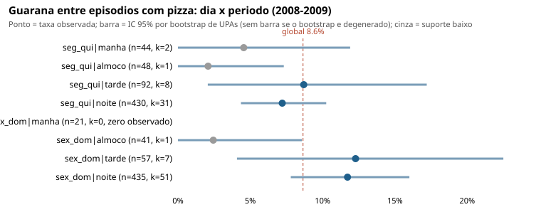
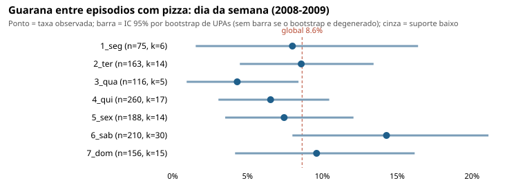
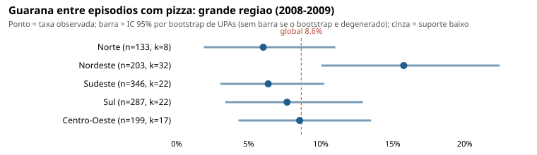
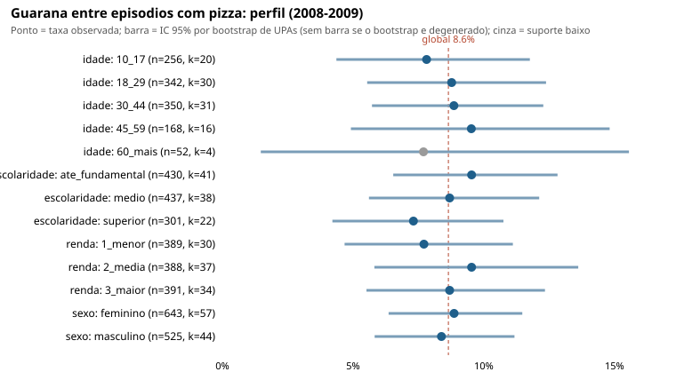

# Documentação técnica — Occasion Intelligence: Pizza + Guaraná

- [Data Card](#data-card)
- [Análise exploratória de 2008](#eda-2008)
- [Protocolo de modelagem](#protocolo-modelagem)

## Data Card

**Desenvolvimento: POF 2008–2009. Avaliação temporal reservada: POF 2017–2018.** O alvo de 2017 fica selado e **não foi aberto** na preparação documentada, nem os pesos. Os resultados descritivos de 2008 estão na [EDA](#eda-2008), reproduzível por `python -m occasion.eda_2008`.

**O que estes dados são, em uma frase.** A POF registra consumo alimentar: o que cada pessoa disse ter comido e bebido, quando e onde. Ela **não comprova** pedidos de delivery, a marca Antarctica nem o efeito de uma ação de marketing; por isso nenhuma leitura deste projeto fala de pedido, marca ou causalidade.

### 1. Unidade de análise

O **episódio**: uma pessoa, em um dia de coleta, em uma hora, em que consumiu pizza (`pessoa × dia × hora`). Identificador `episodio_id`, único por edição. O instante de previsão é a refeição com pizza já definida e a bebida ainda não escolhida.

| Contagem em 2008–2009 | Valor |
|---|---|
| Episódios com pizza | 1.168 |
| Pessoas | 1.106 (1.046 com 1 episódio, 58 com 2 e 2 com 3) |
| Unidades de consumo | 715 (na amostra, cada domicílio tem uma unidade de consumo com pizza) |
| Domicílios | 715 |
| UPAs (unidades primárias de amostragem) | 644 |
| Estratos (UF × estrato) | 293, dos quais 144 com uma única UPA |
| UFs | 27 |

A hora é arredondada pelo IBGE e não há data de calendário: só dia da semana e hora.

### 2. Target (ground truth ou proxy)

`y_guarana = 1` quando o **mesmo episódio** contém um dos seis códigos de refrigerante de guaraná da POF (`8200301`, `8200302`, `8201601`, `8201602`, `8207401`, `8207402`); caso contrário, 0. O tipo de ativação nunca é o alvo.

**É registro autodeclarado de consumo.** Pedido, canal e marca não são observados; o alvo não permite identificá-los. A classificação da POF não tem código de marca de guaraná. Parte do refrigerante é "não especificado" (132 dos 655 episódios com refrigerante), então a taxa identificada pode subestimar o guaraná consumido.

| Medida (2008–2009) | Numerador / denominador | Taxa |
|---|---|---|
| Guaraná entre episódios com pizza | 101 / 1.168 | 8,65% |
| Algum refrigerante entre episódios com pizza | 655 / 1.168 | 56,1% |
| Guaraná entre episódios com refrigerante | 101 / 655 | 15,4% |

**Interpretação do score:** frequência histórica estimada de guaraná em episódios com pizza de contextos parecidos, na amostra de 2008–2009. Não é probabilidade de pedir, preferência pela marca Antarctica, chance de compra nem efeito de promoção.

### 3. Dicionário de variáveis

A coluna "Disponível na aplicação" distingue entradas que **o usuário pode informar** (`sim`), informações indisponíveis no instante da consulta (`não`) e dados somente de diagnóstico. O sistema não observa automaticamente renda ou composição familiar. A especificação inicial tem 13 variáveis derivadas e 28 colunas, definidas em [variaveis.json](../configs/variaveis.json). `log_renda_pc` usa reais de jan/2009; a conversão da renda atual ainda precisa ser implementada na inferência.

| Variável | Descrição e derivação | Origem 2008–09 | Origem 2017–18 | Papel | Disponível na aplicação | Limitação |
|---|---|---|---|---|---|---|
| `hora_manha` | faixa de hora 5–10 h | `V9015` | `V9015` | treino, B1, boosting | sim | hora arredondada |
| `hora_almoco` | faixa de hora 11–14 h | `V9015` | `V9015` | treino, B1, boosting | sim | hora arredondada |
| `hora_tarde` | faixa de hora 15–18 h | `V9015` | `V9015` | treino, B1, boosting | sim | hora arredondada |
| `hora_noite` | faixa de hora 19–4 h (madrugada entra na noite do mesmo dia) | `V9015` | `V9015` | treino, B1, boosting | sim | 2 episódios de 0–4 h em 2008 |
| `sexta_a_domingo` | dia da semana em sexta, sábado ou domingo | `DIA_SEMANA` | `DIA_SEMANA` | treino | sim | composição de dias vem do calendário de coleta |
| `regiao_norte` | grande região, a partir da UF | `COD_UF` | `UF` | treino, B2, segmento | sim | — |
| `regiao_nordeste` | grande região, a partir da UF | `COD_UF` | `UF` | treino, B2, segmento | sim | — |
| `regiao_sudeste` | grande região, a partir da UF | `COD_UF` | `UF` | treino, B2, segmento | sim | — |
| `regiao_sul` | grande região, a partir da UF | `COD_UF` | `UF` | treino, B2, segmento | sim | — |
| `regiao_centro_oeste` | grande região, a partir da UF | `COD_UF` | `UF` | treino, B2, segmento | sim | — |
| `area_capital` | tipo de área: capital | estrato + planilha | estrato + planilha | treino | sim | 3 níveis porque limites metropolitanos mudaram |
| `area_urbano_nao_capital` | tipo de área: urbano fora da capital | estrato + planilha | estrato + planilha | treino | sim | idem |
| `area_rural` | tipo de área: rural | estrato + planilha | estrato + planilha | treino | sim | idem |
| `idade_10_17` | faixa etária 10–17 | `IDADE_ANOS` | `V0403` | treino, segmento | sim | data de referência difere em menos de um ano |
| `idade_18_29` | faixa etária 18–29 | `IDADE_ANOS` | `V0403` | treino, segmento | sim | idem |
| `idade_30_44` | faixa etária 30–44 | `IDADE_ANOS` | `V0403` | treino, segmento | sim | idem |
| `idade_45_59` | faixa etária 45–59 | `IDADE_ANOS` | `V0403` | treino, segmento | sim | idem |
| `idade_60_mais` | faixa etária 60 ou mais | `IDADE_ANOS` | `V0403` | treino, segmento | sim | 52 episódios em 2008 |
| `sexo_feminino` | sexo feminino (1) ou masculino (0) | `V0405` | `V0404` | treino | sim | — |
| `escolaridade_ate_fundamental` | níveis 1–3 do IBGE | `NIVEL_INSTRUCAO_MORADOR` | `NIVEL_INSTRUCAO` | treino | sim | algoritmo de derivação do IBGE não documentado |
| `escolaridade_medio` | níveis 4–5 do IBGE | `NIVEL_INSTRUCAO_MORADOR` | `NIVEL_INSTRUCAO` | treino | sim | idem |
| `escolaridade_superior` | níveis 6–7 do IBGE | `NIVEL_INSTRUCAO_MORADOR` | `NIVEL_INSTRUCAO` | treino | sim | idem |
| `log_renda_pc` | log da renda total da unidade de consumo ÷ todos os moradores, em reais de jan/2009 | `RENDA_TOTAL` | `RENDA_TOTAL` × 0,5895 (IPCA) | treino, segmento | sim | inclui renda não monetária e variação patrimonial; em reais de jan/2009, sem conversão de renda atual ainda |
| `moradores_uc` | número de moradores da unidade de consumo | cadastro de moradores | cadastro de moradores | treino | sim | atributo compartilhado pelos episódios da mesma unidade de consumo |
| `presenca_crianca_0_11` | há morador de 0 a 11 anos | cadastro de moradores | cadastro de moradores | treino | sim | — |
| `presenca_adolescente_12_17` | há morador de 12 a 17 anos | cadastro de moradores | cadastro de moradores | treino | sim | associada à faixa 10–17 do próprio episódio |
| `presenca_idoso_60_mais` | há morador com 60 anos ou mais | cadastro de moradores | cadastro de moradores | treino | sim | — |
| `sexta_a_domingo_x_noite` | interação: sexta a domingo e faixa noite | derivada | derivada | treino | sim | igual ao produto de duas colunas acima |
| `dia_semana` | dia da semana em 7 níveis (nativa) | `DIA_SEMANA` | `DIA_SEMANA` | B1 e boosting | sim | composição pelo calendário de coleta |
| `idade` | idade em anos (nativa) | `IDADE_ANOS` | `V0403` | boosting, alternativa | sim | — |
| `uf` | unidade da federação, 27 níveis | `COD_UF` | `UF` | só relato por segmento | sim | nenhuma UF tem 30 positivos |
| `indicadores_uf_sidra` | 4 indicadores de Censo e PNAD por UF e edição | SIDRA 2000 e 2006 | SIDRA 2010 e 2015 | contexto descritivo, fora do modelo | somente diagnóstico | no treino são a UF reescrita |
| `cod_upa` | UPA do episódio | cadastro | cadastro | grupo da validação cruzada e do bootstrap | não | — |
| `peso_final` | peso da pessoa (calibrado por UF, sexo e idade) | `PESO_FINAL` | `PESO_FINAL` (selado) | só sensibilidade ponderada (W1) | não | ver item 8 |
| `dia_coleta` | primeiro ou segundo dia de coleta | quadro 71/72 | quadro 72/73 | só diagnóstico | não | artefato do instrumento; não existe na consulta |
| `local_refeicao_v9018` | local da refeição | `V9018` | `V9018` | nenhum | não | muda de conceito entre as edições |
| `ocasiao_consumo` | ocasião declarada | ausente | presente | nenhum | não | não comparável |
| `dia_atipico` | dia atípico declarado | ausente | presente | nenhum | não | não comparável |
| `y_guarana` | alvo: guaraná no mesmo episódio | itens de consumo | itens de consumo (selado) | alvo | não | consumo autodeclarado; ver item 2 |
| `y_refrigerante` | algum refrigerante no mesmo episódio | itens de consumo | itens de consumo | só descrição | não | parte do desfecho |

### 4. Fontes e versões

Única fonte de registros observados de consumo: microdados da **POF** do IBGE, baixados por código com verificação de SHA-256 (`configs/manifesto_fontes.json`). Nenhuma outra fonte tem chave comum com o episódio (veja o item 5).

| Arquivo | Edição | Baixado em |
|---|---|---|
| `Dados_20231009.zip` | 2008–2009 | 30/10/2026 |
| `Documentacao_20231009.zip` | 2008–2009 | 30/10/2026 |
| `Dados_20230713.zip` | 2017–2018 | 30/10/2026 |
| `Documentacao_20230713.zip` | 2017–2018 | 27/10/2026; recuperado em 09/11/2026 |

URLs completas, tamanhos e SHA-256 ficam no [manifesto de fontes](../configs/manifesto_fontes.json), usado pelo pipeline na verificação dos downloads.

URLs em `ftp.ibge.gov.br/Orcamentos_Familiares/`, pastas `Pesquisa_de_Orcamentos_Familiares_2008_2009` e `..._2017_2018` (subpasta `Microdados`).

- **Contexto por UF** (`configs/contexto_uf.csv`): quatro indicadores do SIDRA (Censo 2000 e 2010; PNAD 2006 e 2015), só descritivos.
- **Correção de renda:** IPCA de jan/2009 (2.906,74) e jan/2018 (4.930,72); fator 0,5895163 multiplica só a renda de 2017–2018.
- **Ambiente:** Python 3.12, `duckdb==2.0.0`, `xlrd==2.0.2`, versões fixadas em `uv.lock`.
- **Entradas definitivas de 2008:** `e2_2008.csv`, `features_comuns_2008.csv`, `identificadores_2008.csv`, `variaveis_nativas_2008.csv` e `matriz_logistica_2008.csv`. Caminho relativo à raiz dos dados: `pkg_f1_01/pe01_v2/execucao_2/saida`, informado por `CASE_AMBEV_SAIDA_ROOT` ou `--saida`. Os SHA-256 estão centralizados em [entradas_2008.json](../configs/entradas_2008.json) e são conferidos antes da leitura. A pasta antiga sem as matrizes é recusada. Duas execuções seguidas produziram os mesmos hashes.

### 5. Regras de integração

- **Chaves.** Pessoa = UPA, domicílio, unidade de consumo e informante dentro de cada edição; UPA = UF (2) + sequência (3) + dígito (1). As edições nunca são unidas por chave: elas só se comparam por conceitos harmonizados.
- **Junções de 2008** (consumo → moradores → domicílio): sem perda nem duplicação, 1.168 episódios antes e depois de cada junção; chaves únicas conferidas; 30 de 30 contagens de referência da auditoria do projeto reproduzidas (não são 30 estatísticas publicadas pelo IBGE).
- **Alinhamento por `episodio_id`.** `variaveis_nativas`, `matriz_logistica` e `identificadores` têm a mesma ordem de linhas, por `episodio_id`. A EDA conferiu 14 checagens (mesmos episódios, ordem, UPA, peso, dia, região, área, idade, sexo, faixa de hora, interação e alvo dentro de refrigerante): 0 divergências em 1.168 episódios.
- **Harmonização entre edições** (`configs/crosswalk.json`, `configs/variaveis.json`): dia da semana 1 = segunda … 7 = domingo; hora inteira 0–23; área em 3 níveis; escolaridade em 3 níveis; renda corrigida pelo IPCA. Uma única função (`derivar_nativas`) aplica as regras às duas edições.
- **Fontes que não se integram.** Clima, feriados, Google Trends e OpenStreetMap ficam fora do núcleo: a POF não tem data de calendário nem município, então nenhuma chave coerente existe. Fontes de granularidades incompatíveis não são combinadas como se fossem a mesma observação.

### 6. Estratégia anti-leakage

- **Instante de previsão:** a refeição com pizza está definida; a bebida ainda não. Toda variável precisa existir nesse instante.
- **Nunca entram:** `dia_coleta`, local da refeição, ocasião, dia atípico e qualquer indicador de refrigerante do episódio (tabela do item 3).
- **Nada é aprendido dos dados na preparação.** Imputação, padronização e cortes por quantil ficam dentro das dobras de treino. Os tercis de renda da EDA são só descritivos e não entram na matriz do modelo.
- **Mesmo processamento no treino e na inferência**, pela função única de derivação.
- **Validação:** divisão sempre agrupada por UPA (pessoas e domicílios do mesmo lado); incerteza por bootstrap de UPAs inteiras; seleção só com dados de 2008.
- **Separação temporal:** desenvolvimento em 2008–2009; avaliação em 2017–2018, aberta **uma única vez**, com protocolo, variáveis, modelos e limiares congelados antes. O alvo e os pesos de 2017 estão em pasta somente leitura, fora do repositório, e **não foram abertos**. O módulo de 2017 nunca importa as listas de bebidas.
- **Exposição prévia:** os agregados de 2017 já eram conhecidos antes do congelamento: 1.703 episódios com pizza e 181 positivos (10,6%; 9,5% ponderado). Portanto, a avaliação temporal não é cega e deve ser interpretada com essa limitação.

### 7. População coberta e excluída

**Coberta:** moradores com 10 anos ou mais da subamostra de consumo alimentar da POF, em domicílios particulares, que consumiram pizza em algum dia de registro.

**Excluídos:** menores de 10 anos; domicílios coletivos; pessoas sem registro de consumo; quem não comeu pizza nos dias de registro.

| Passo (2008–2009) | Contagem |
|---|---|
| Pessoas com consumo registrado | 34.003 |
| Episódios (pessoa × dia × hora) no total | 287.680 |
| Episódios com pizza (população do estudo) | 1.168, de 1.106 pessoas |
| 2017–2018: episódios elegíveis (alvo selado) | 1.703 (contagem já verificada; sem nova tabulação) |

Não cobre: quem não consome pizza, menores de 10 anos, domicílios coletivos, consumo fora da janela de registro, nem qualquer comportamento de compra.

### 8. Vieses e limitações

- **Consumo registrado, não compra.** Sem informação de quem comprou, quanto pagou ou se foi combo. A POF registra consumo alimentar e **não comprova** pedidos de delivery, a marca Antarctica nem o efeito de uma ação de marketing.
- **Sem canal.** Delivery, restaurante e aplicativo não existem no bloco de consumo.
- **Sem marca.** Nenhum código de marca de guaraná; o alvo é um limite inferior de guaraná.
- **Instrumentos diferentes.** 2008–09 é registro alimentar preenchido pela pessoa; 2017–18 é recordatório de 24 h por entrevista. A diferença de taxa entre edições mistura tempo e instrumento e não é tendência. A água só é registrada em 2017–18.
- **Calendário de coleta.** Domingo é 13,4% dos episódios de pizza em 2008 e 32,2% em 2017; 41% dos episódios de 2008 estão no 1º dia de coleta e 59% no 2º. Nem pesos nem modelo removem esse efeito de desenho.
- **Dependência entre episódios.** 752 dos 1.168 episódios (64%) estão em domicílios com 2 ou mais episódios; ICC ≈ 0,65 entre moradores do mesmo domicílio. Os 101 positivos estão em 75 domicílios e 70 UPAs; **não são 101 observações independentes**. Os intervalos das tabelas e figuras são percentis do bootstrap de UPAs; o intervalo de Wilson aparece só como comparação e supõe episódios independentes. Com todos os resultados iguais (k = 0 ou k = n), o bootstrap é degenerado e não gera intervalo.
- **Grupos pequenos.** Manhã (65 episódios, 2 positivos) e almoço (89, 2) têm suporte baixo; nenhuma UF tem 30 positivos; 144 de 293 estratos têm uma só UPA. Zero observado não é probabilidade zero.
- **Pesos.** O IBGE fornece o peso da pessoa (W0), constante dentro da pessoa. O peso W1 (peso da pessoa ÷ dias de registro) é **derivado** e usado somente em análise de sensibilidade; a leitura principal é sem pesos. Pesos variam de 349 (percentil 1) a 33.901 (percentil 99); dois episódios têm peso 1,0.
- **Colinearidade.** As 28 colunas incluem 5 conjuntos completos de indicadores (hora, região, área, idade, escolaridade) que somam 1 e são colineares com o intercepto; exigem penalização, como ridge, ou um nível de referência.
- **Representatividade.** Dados de 2008–2009, com mais de 15 anos; os contextos de hoje podem ser outros.
- **Sem causalidade.** Nenhuma leitura pode afirmar que uma ativação venderá mais.

### 9. Licença e cuidados com LGPD

- **Licença.** A licença específica dos microdados do IBGE **não foi confirmada**. Microdados e derivados linha a linha não são redistribuídos.
- **Redistribuição.** Microdados e derivados linha a linha **nunca** entram no repositório (`.gitignore`); só tabelas agregadas e figuras são publicadas. Convenção implementada (do projeto, sem garantia): em tabelas e figuras, níveis com 1 a 4 episódios saem com n, k e taxas suprimidos; níveis com n ≥ 5 saem completos, inclusive com k de 1 a 4. A prosa dos documentos cita algumas contagens pequenas de estrutura e não segue essa convenção.
- **LGPD.** Os microdados tratam de pessoas reais. O projeto **não conferiu** campo a campo a ausência de identificadores diretos nem o risco de reidentificação por combinação de variáveis; a disponibilidade pública dos microdados não prova ausência de risco, e o limiar n < 5 não é garantia de anonimização. Por precaução, são tratados como potencialmente reidentificáveis. Não há tentativa de reidentificação nem de cruzamento com outras bases pessoais.

<a id="eda-2008"></a>

## Análise exploratória — POF 2008–2009

**Dados de desenvolvimento: POF 2008–2009.** Leitura principal **sem pesos**; n = episódios e k = episódios com guaraná. Os achados são **exploratórios** e não constituem seleção de variáveis por desempenho.

**Avaliação temporal:** houve exposição prévia a resultados agregados de 2017; esta análise usa somente 2008. Os detalhes e as restrições estão no [Data Card, item 6](#6-estratégia-anti-leakage).

**Intervalos de 95%, sempre com o método nomeado.** As tabelas e figuras usam dois métodos, nunca misturados na mesma coluna:
- **IC boot.**: percentil do bootstrap de UPAs inteiras (5.000 réplicas, semente 20261113; limites = quantis 2,5% e 97,5% das réplicas, com interpolação linear, o "tipo 7"). Respeita a dependência entre episódios da mesma UPA, mas ignora o estrato e é condicional à presença do nível na reamostra. É o intervalo das figuras.
- **Wilson**: intervalo analítico que **supõe episódios independentes**. Aparece só na tabela 5.1, como comparação, e nos casos sem variação. Nenhum dos dois é limite garantido do outro.
- **Bootstrap degenerado.** Quando todos os episódios de um nível têm o mesmo resultado (k = 0 ou k = n), toda réplica repete esse valor: a variância estimada é zero e a dependência entre episódios não entra no intervalo. Nesses casos o IC boot. **não é publicado** ("degenerado") e as figuras mostram "zero observado" sem ponto nem barra. Ocorre em `sexta a domingo · manhã` (k = 0 em 21) e em 4 UFs.
- **Réplicas descartadas.** Uma réplica é descartada para um nível quando nenhuma UPA daquele nível é sorteada (taxa indefinida). Nos níveis com n ≥ 5 só três UFs perderam réplicas (UF 16 e 17: 1 de 5.000; UF 23: 5 de 5.000). O contraste de sexta a domingo não descartou nenhuma. Os registros de execução (fora do repositório) trazem a contagem por nível.
- **Estabilidade.** Repetindo as tabelas de período, dia da semana e região com cinco sementes, os limites do IC boot. variam até 0,6 ponto percentual (período), 0,45 (dia) e 0,29 (região); o contraste, 0,23. Números citados abaixo têm, portanto, incerteza de Monte Carlo da ordem de 0,3 a 0,6 ponto; casas decimais além da primeira não são informativas.

**Convenção de mascaramento (do projeto; sem garantia de anonimização).** Nas tabelas e figuras, níveis com 1 a 4 episódios saem com n, k e taxas suprimidos ("<5"). Níveis com n ≥ 5 saem completos, **inclusive com k de 1 a 4**. A convenção vale só para as tabelas e figuras geradas por código: a prosa deste documento cita contagens pequenas de estrutura (por exemplo 2 pessoas com 3 episódios). Os microdados do IBGE são públicos, o que não prova, por si, ausência de risco de identificação; nenhuma conferência de campos identificadores foi feita por este projeto.

Reprodução: `python -m occasion.eda_2008 --destino <pasta>`, com `CASE_AMBEV_SAIDA_ROOT` apontando para as entradas de desenvolvimento e `CASE_AMBEV_RAW_ROOT` para os dados públicos (necessário ao W1). Os cinco arquivos são validados pelos SHA-256 de `configs/entradas_2008.json` (Data Card, item 4). Duas execuções seguidas produziram arquivos idênticos: 17 tabelas, 4 figuras e o registro. CSVs completos e registros ficam externos ao repositório; as tabelas necessárias à leitura estão neste documento.

### 1. Integridade das junções

As cinco entradas de 2008 (`e2`, `features_comuns`, `identificadores`, `variaveis_nativas`, `matriz_logistica`) foram alinhadas por `episodio_id`. As matrizes não trazem esse identificador: o alinhamento delas é por posição, conferido contra os campos comuns.

| Checagem | Resultado |
|---|---|
| Mesmos 1.168 episódios, sem duplicados, na mesma ordem (por `episodio_id`) | passa |
| UPA e peso de `identificadores` = `e2` | 0 divergências em 1.168 |
| Dia da semana, região, área, idade e sexo das variáveis nativas = `features_comuns` | 0 divergências |
| Faixa de hora derivada da hora; matriz = nativas; sexta a domingo nativas = matriz | 0 divergências |
| Alvo de guaraná contido em "algum refrigerante" | 0 divergências |
| Peso constante dentro da pessoa | 0 pessoas com mais de um peso |
| Valores desconhecidos nas 28 colunas; renda inválida | 0; 1.168 rendas válidas |

As taxas são 7,9927% com W1, 8,011% com o peso integral da pessoa (W0) e 8,647% sem pesos.

### 2. Contagens e dependência entre episódios

| Unidade | Contagem | Observação |
|---|---|---|
| Episódios (positivos) | 1.168 (101) | |
| Pessoas | 1.106 | 1.046 com 1 episódio, 58 com 2, 2 com 3 |
| Unidades de consumo e domicílios | 715 e 715 | uma unidade de consumo com pizza por domicílio |
| UPAs | 644 | 351 com 1 episódio; 817 episódios em UPAs com 2 ou mais |
| Estratos (UF × estrato) | 293 | 144 com uma única UPA |
| UFs | 27 | |

- **752 dos 1.168 episódios (64%)** estão em domicílios com 2 ou mais episódios (299 domicílios).
- Os 101 positivos estão em **75 domicílios e 70 UPAs**. Em 17 domicílios há 2 positivos, em 3 há 3 e em 1 há 4; 47 positivos estão em domicílios com 2 ou mais positivos. Eles **não são 101 observações independentes**.
- Variáveis de domicílio (moradores, presenças, renda) são constantes entre os episódios do mesmo domicílio: 0 domicílios com valores diferentes.

### 3. Distribuição das variáveis, ausências, extremos e categorias raras

**Ausências.** Nenhuma das 28 colunas tem valor desconhecido; todas as 1.168 rendas são válidas.

**Extremos.**

| Variável | Resumo |
|---|---|
| Renda per capita (R$ de jan/2009) | mín. 52; p1 100; mediana 885; p99 7.554; máx. 26.700. 9 episódios acima de 10 medianas; 12 fora de 1,5 IQR no log |
| Idade (anos) | 10 a 94; mediana 29; p95 58 |
| Moradores na unidade de consumo | 1 a 11; 3 e 4 moradores são os mais comuns (338 e 325); 4 episódios com 9 ou mais |
| Peso da pessoa | p1 349; mediana 3.572; p99 33.901; máx. 60.533; 2 episódios com peso 1,0 |
| Hora | 2 episódios entre 0 h e 4 h (entram na faixa noite) |

**Distribuição e suporte.** Faixa de hora: noite 865 (74,1%), tarde 149 (12,8%), almoço 89 (7,6%), manhã 65 (5,6%). Sexta a domingo: 554 (47,4%). Domingo tem 156 episódios (13,4%).

**Categorias raras** (menos de 30 episódios ou menos de 5 positivos; só leitura descritiva): manhã e almoço (k = 2 cada); 60 anos ou mais (n = 52, k = 4); moradores = 1 (n = 41, k = 2); 4 combinações de dia × faixa de hora (manhã e almoço, nos dois tipos de dia), entre elas `sex_dom|manhã` (n = 21, k = 0); 18 das 27 UFs (nenhuma UF chega a 30 positivos: o maior é k = 11); No total, 30 linhas de tabela têm suporte baixo, contando 4 níveis vazios (`desconhecida` e `sem_renda`). A hora isolada (0 a 23 h) não é mais tabulada: níveis com 1 episódio seriam suprimidos e a soma pelo total os revelaria.

### 4. Distribuição do alvo

| Medida | k / n | Taxa |
|---|---|---|
| Guaraná entre episódios com pizza | 101 / 1.168 | 8,65% |
| Algum refrigerante entre episódios com pizza | 655 / 1.168 | 56,1% |
| Guaraná entre episódios com refrigerante | 101 / 655 | 15,4% |

O alvo é raro (cerca de 1 em 12). Como 132 dos 655 episódios com refrigerante são "não especificado", a taxa identificada pode subestimar o guaraná consumido.

### 5. Guaraná entre episódios com pizza, por contexto

Todas as taxas são **sem peso**. "IC boot." é o bootstrap de UPAs; "Wilson", onde aparece, supõe independência; "W1" é a taxa ponderada (item 6), sem intervalo. Taxas de grupos com k < 5 são só descrição.

#### 5.1 Período

| Nível | n | k | Taxa (%) | IC boot. (%) | Wilson (%) | W1 (%) | Suporte |
|---|---|---|---|---|---|---|---|
| Segunda a quinta | 614 | 42 | 6,8 | 4,5 a 9,4 | 5,1 a 9,1 | 6,4 | ok |
| Sexta a domingo | 554 | 59 | 10,7 | 7,3 a 14,2 | 8,3 a 13,5 | 9,4 | ok |
| Manhã | 65 | 2 | 3,1 | 0,0 a 8,2 | 0,8 a 10,5 | 4,8 | baixo |
| Almoço | 89 | 2 | 2,2 | 0,0 a 6,0 | 0,6 a 7,8 | 1,8 | baixo |
| Tarde | 149 | 15 | 10,1 | 4,7 a 16,3 | 6,2 a 15,9 | 9,7 | ok |
| Noite | 865 | 82 | 9,5 | 6,9 a 12,1 | 7,7 a 11,6 | 8,7 | ok |
| Segunda a quinta · manhã | 44 | 2 | 4,5 | 0,0 a 11,9 | 1,3 a 15,1 | 6,0 | baixo |
| Segunda a quinta · almoço | 48 | 1 | 2,1 | 0,0 a 7,3 | 0,4 a 10,9 | 2,3 | baixo |
| Segunda a quinta · tarde | 92 | 8 | 8,7 | 2,1 a 17,2 | 4,5 a 16,2 | 5,9 | ok |
| Segunda a quinta · noite | 430 | 31 | 7,2 | 4,4 a 10,3 | 5,1 a 10,1 | 7,2 | ok |
| Sexta a domingo · manhã | 21 | 0 | 0,0 | — (degenerado) | 0,0 a 15,5 | 0,0 | baixo |
| Sexta a domingo · almoço | 41 | 1 | 2,4 | 0,0 a 8,6 | 0,4 a 12,6 | 1,2 | baixo |
| Sexta a domingo · tarde | 57 | 7 | 12,3 | 4,1 a 22,5 | 6,1 a 23,2 | 17,4 | ok |
| Sexta a domingo · noite | 435 | 51 | 11,7 | 7,8 a 16,0 | 9,0 a 15,1 | 9,8 | ok |



- **Comparação exploratória.** Sexta a domingo menos segunda a quinta = **+3,8 pontos percentuais**, IC boot. de **−0,2 a +8,1**, com 5.000 réplicas. A escolha do contraste ocorreu após a consulta às taxas por dia. O intervalo inclui zero e também comporta diferenças de alguns pontos; a estimativa não comprova a diferença entre os grupos. A avaliação temporal preserva a ressalva de exposição prévia descrita no Data Card.
- Manhã e almoço têm 4 positivos em 154 episódios (2,6%), com k = 2 em cada: a amostra não permite afirmar que a taxa seja baixa nem que seja zero.
- **Zero observado.** `sexta a domingo · manhã` tem **0 positivos em 21 episódios** (19 UPAs). O bootstrap é degenerado (acima) e não gera intervalo. Wilson dá 0,0 a 15,5%, supondo independência. O método exato de Clopper-Pearson sobre os mesmos 21 episódios dá limite superior de 16,1%, e tratando as 19 UPAs como unidades, 17,7%. Os métodos diferem e nenhum é intervalo garantido para observações agrupadas: o zero observado é compatível com taxas de alguns pontos acima de 15%, conforme o método, e não é probabilidade zero.

#### 5.2 Dia da semana

| Dia | n | k | Taxa (%) | IC boot. (%) | W1 (%) |
|---|---|---|---|---|---|
| Segunda | 75 | 6 | 8,0 | 1,5 a 16,4 | 5,4 |
| Terça | 163 | 14 | 8,6 | 4,5 a 13,4 | 6,7 |
| Quarta | 116 | 5 | 4,3 | 0,9 a 8,4 | 3,5 |
| Quinta | 260 | 17 | 6,5 | 3,1 a 10,5 | 8,3 |
| Sexta | 188 | 14 | 7,4 | 3,5 a 12,1 | 4,0 |
| Sábado | 210 | 30 | 14,3 | 8,0 a 21,1 | 15,8 |
| Domingo | 156 | 15 | 9,6 | 4,2 a 16,2 | 7,5 |



O sábado tem a maior taxa observada (14,3%) e 30 dos 59 positivos de sexta a domingo. As comparações entre dias não foram testadas diretamente, e sobreposição de intervalos não prova igualdade nem diferença (é um critério conservador): a amostra não permite dizer que a sexta difere dos dias úteis nem descartar diferenças de alguns pontos. Sete comparações olhadas depois dos dados: **exploratório**.

#### 5.3 Região

| Região | n | k | Taxa (%) | IC boot. (%) | W1 (%) |
|---|---|---|---|---|---|
| Norte | 133 | 8 | 6,0 | 1,9 a 11,0 | 8,3 |
| Nordeste | 203 | 32 | 15,8 | 10,1 a 22,4 | 20,8 |
| Sudeste | 346 | 22 | 6,4 | 3,0 a 10,2 | 4,9 |
| Sul | 287 | 22 | 7,7 | 3,4 a 12,9 | 9,3 |
| Centro-Oeste | 199 | 17 | 8,5 | 4,3 a 13,5 | 6,7 |



O Nordeste concentra 32 dos 101 positivos (32%) e tem a maior taxa nas duas leituras. A diferença não depende de uma UF só: retirando, uma de cada vez, as nove UFs nordestinas, a taxa do Nordeste fica entre 14,0% e 17,1%, acima das demais regiões (6,0% a 8,5%; 69 de 965, ou 7,2%, juntas). Os 32 positivos estão em 24 UPAs, com no máximo 2 por UPA; nas UFs com pelo menos 5 positivos aparecem 9/44 (BA), 7/25 (PE) e 6/36 (MA). Ainda assim é um achado olhado depois dos dados, entre cinco regiões e com UPAs agrupadas: hipótese para a validação por região, não regra.

#### 5.4 Perfil

| Característica | n | k | Taxa (%) | IC boot. (%) | W1 (%) |
|---|---|---|---|---|---|
| Capital / urbano fora da capital / rural | 377 / 671 / 120 | 35 / 56 / 10 | 9,3 / 8,3 / 8,3 | 5,7–13,5 / 5,8–11,2 / 2,0–15,8 | 8,2 / 7,8 / 7,5 |
| Feminino / masculino | 643 / 525 | 57 / 44 | 8,9 / 8,4 | 6,4–11,5 / 5,8–11,2 | 8,2 / 7,8 |
| 10–17 anos | 256 | 20 | 7,8 | 4,4–11,8 | 11,0 |
| 18–29 anos | 342 | 30 | 8,8 | 5,5–12,4 | 5,1 |
| 30–44 anos | 350 | 31 | 8,9 | 5,7–12,3 | 11,4 |
| 45–59 anos | 168 | 16 | 9,5 | 4,9–14,8 | 5,2 |
| 60 anos ou mais | 52 | 4 | 7,7 | 1,5–15,6 | 3,8 |
| Até fundamental / médio / superior | 430 / 437 / 301 | 41 / 38 / 22 | 9,5 / 8,7 / 7,3 | 6,5–12,8 / 5,6–12,1 / 4,2–10,8 | 11,0 / 7,8 / 4,6 |
| Renda per capita: menor / média / maior tercil | 389 / 388 / 391 | 30 / 37 / 34 | 7,7 / 9,5 / 8,7 | 4,7–11,1 / 5,8–13,6 / 5,5–12,3 | 10,3 / 8,2 / 5,9 |
| Moradores: 1 / 2 / 3 / 4 / 5+ | 41 / 202 / 338 / 325 / 262 | 2 / 19 / 33 / 18 / 29 | 4,9 / 9,4 / 9,8 / 5,5 / 11,1 | 0,0–12,5 / 4,9–14,7 / 5,9–14,0 / 3,0–8,5 / 6,1–16,8 | 2,9 / 4,4 / 9,9 / 4,8 / 14,1 |
| Criança 0–11 no domicílio: sem / com | 667 / 501 | 53 / 48 | 7,9 / 9,6 | 5,4–10,7 / 6,3–13,0 | 7,1 / 9,4 |
| Adolescente 12–17 no domicílio: sem / com | 717 / 451 | 58 / 43 | 8,1 / 9,5 | 5,8–10,6 / 5,9–13,6 | 5,8 / 11,2 |
| Idoso 60+ no domicílio: sem / com | 977 / 191 | 87 / 14 | 8,9 / 7,3 | 6,6–11,3 / 3,0–12,2 | 8,6 / 5,0 |



Sem pesos, sexo, área, faixa etária e renda ficam entre 7,7% e 9,5%, com intervalos largos que se cruzam. Isso mostra que a amostra não revela diferença nítida entre esses grupos, mas não descarta diferenças de alguns pontos, e a sobreposição de intervalos não é teste de igualdade. Escolaridade tem declive observado (9,5% → 7,3%), não testado. As taxas por número de moradores (4,9; 9,4; 9,8; 5,5; 11,1%) não seguem ordem monótona e não há explicação testada; com 1 morador, k = 2. **A renda não mostra gradiente na taxa de guaraná sem pesos**; isso não contradiz o TAPI, que fala de consumo de pizza e de associação por classe, outra quantidade. Com W1, renda e escolaridade passam a mostrar gradiente (item 6): as duas leituras discordam. Os tercis de renda foram calculados com todos os episódios de 2008 e são **só descritivos** (não entram no modelo).

### 6. Pesos: W1 como sensibilidade e suas limitações

- **O que é W1.** Peso da pessoa (`PESO_FINAL`, do IBGE) dividido pelo número de dias de registro da pessoa no arquivo de consumo (quadros 71 e 72 são o 1º e o 2º dia de coleta). É uma **ponderação derivada**, não um peso por dia fornecido pelo IBGE. 18 episódios são de pessoas com 1 dia de registro e 1.150 de pessoas com 2.
- **Leitura principal sem pesos.** A pergunta de comparação entre modelos é qual deles prevê melhor a condicional na amostra; o peso responde a outra e custa precisão.
- **Limitações.** O peso é calibrado por UF, sexo e idade, mas **não corrige a composição por dia da semana** (domingo é 13,4% dos episódios em 2008 e 32,2% em 2017) nem a diferença entre o 1º e o 2º dia. Os pesos são desiguais (p1 349, p99 33.901): estimativas por grupo pequeno oscilam muito, por exemplo a taxa por faixa etária vai de 3,8% a 11,4% com W1 contra 7,7% a 9,5% sem pesos. O bootstrap por UPA ignora o estrato; 144 dos 293 estratos têm uma só UPA, portanto os IC ponderados são aproximações. O IC ponderado não é mostrado onde o bootstrap é degenerado.
- **Sinais que mudam com W1:** o declive por escolaridade fica mais forte (11,0% → 4,6%) e o da renda aparece (10,3% → 5,9%), enquanto sem pesos a renda é plana. Essa diferença entre as duas leituras é um diagnóstico de que os pesos importam, não uma conclusão sobre renda.
- **Dia de coleta (diagnóstico do instrumento, fora do modelo).** 1º dia: 37 de 484 (7,6%); 2º dia: 64 de 684 (9,4%).
- **O que W1 estima.** A proporção de episódios com guaraná entre os com pizza num dia médio de registro, na população de pessoas; para as 18 pessoas com 1 só dia, supõe-se que esse dia represente os dois.
- **Não** se usa aproximação de Kish como tamanho de amostra de treinamento.

### 7. Redundâncias entre indicadores e variáveis

- **Colinearidade exata.** As 28 colunas incluem **5 conjuntos completos de indicadores** (hora, região, área, idade, escolaridade) que somam 1 em todos os 1.168 episódios: cada um é colinear com o intercepto (28 colunas, posto 24). Com penalização (ridge), a solução é única; sem penalização, a logística não seria identificada.
- **Interação.** `sexta_a_domingo_x_noite` é exatamente o produto de `sexta_a_domingo` por `hora_noite` (confirmado em 1.168 episódios) e tem correlação 0,81 com `sexta_a_domingo`. Ser produto de duas colunas **não** a torna combinação linear delas: ela acrescenta uma dimensão ao posto da matriz (posto 24 com a interação e 23 sem, nas 28 colunas e também com intercepto). Correlação alta não é dependência linear, e a interação não é redundante no sentido do posto.
- **Pares de colunas com correlação absoluta ≥ 0,5:** `sexta_a_domingo` × interação (0,81); `area_capital` × `area_urbano_nao_capital` (−0,80); `hora_tarde` × `hora_noite` (−0,65); `escolaridade_ate_fundamental` × `escolaridade_medio` (−0,59); `idade_10_17` × `presenca_adolescente_12_17` (0,53).
- **Associação entre variáveis nativas (V de Cramér ≥ 0,3, sem o alvo):** faixa etária × presença de adolescente (0,55), faixa etária × presença de idoso (0,49), moradores × presença de criança (0,45), faixa etária × escolaridade (0,38), moradores × presença de adolescente (0,38). A faixa etária do próprio episódio e a composição do domicílio contam parte da mesma informação.
- **Unidade de consumo = domicílio** na amostra: moradores, presenças e renda são constantes por domicílio e repetem o mesmo valor entre seus episódios.

### 8. Consequências para validação, interpretação e modelagem

**Validação.**
- Agrupar sempre por UPA (pessoa e domicílio ficam do mesmo lado). Com 101 positivos em 70 UPAs, cada dobra de 10 terá em média cerca de 10 positivos: estratificar e repetir a validação, e relatar a variação entre repetições.
- Deixar uma região fora é informativo mas frágil: Norte tem 8 positivos e Nordeste, 32. A avaliação por região deve mostrar n e k e não taxa onde k < 5.
- O IC por UPA ignora o estrato (144 dos 293 estratos têm uma só UPA) e é condicional à presença do nível; não é limite garantido para outros métodos de intervalo.
- Em 2017 o domingo pesa 32,2% dos episódios; qualquer diferença entre 2008 e 2017 mistura calendário, instrumento e tempo.

**Interpretação.**
- O score é a frequência histórica de guaraná em episódios com pizza de contextos parecidos em 2008–09; não é chance de pedir, nem preferência pela marca, nem efeito de ação.
- Taxas em grupos com k < 5 não devem virar recomendação; a classe `evidencia_insuficiente` do Decision Engine tem base empírica.
- Zero observado (por exemplo `sex_dom|manhã`) não é probabilidade zero.

**Modelagem (sem concluir sobre desempenho).**
- Os dados mostram heterogeneidade modesta no perfil e mais no calendário e na região; **isso não permite antecipar se um modelo superará o baseline por dia e período, nem que não funcionará**. Só a validação dirá.
- Os indicadores completos exigem tratamento explícito da colinearidade. A especificação inicial prevê logística com penalização ridge; intercepto e escala devem ser definidos antes do ajuste.
- A associação descritiva não demonstra a contribuição preditiva de um grupo de variáveis; essa contribuição exige comparação entre modelos em dados de validação.

<a id="protocolo-modelagem"></a>

## Protocolo de modelagem

Versão 1.0, de 14/11/2026. Os parâmetros ficam em [`configs/protocolo_modelagem.json`](../configs/protocolo_modelagem.json). O SHA-256 desse arquivo foi registrado antes do primeiro ajuste, e a execução recusa um arquivo com hash diferente. Qualquer mudança exige nova versão do protocolo.

Execução:

```bash
OMP_NUM_THREADS=1 OPENBLAS_NUM_THREADS=1 PYTHONPATH=src \
  python -m occasion.modelagem_2008 --destino <pasta fora do repositório> --protocolo-sha256 <hash registrado>
python -m occasion.modelagem_2008 --comparar <execução 1> <execução 2>
```

Variáveis de ambiente: `CASE_AMBEV_SAIDA_ROOT` aponta para as cinco entradas de 2008 (conferidas por [`entradas_2008.json`](../configs/entradas_2008.json)), e `CASE_AMBEV_RAW_ROOT` aponta para os microdados, usados no peso W1.

### 1. Dados e variáveis

- **Episódios:** os 1.168 de 2008–2009 (101 positivos, 644 UPAs).
- **Logística:** as 28 colunas de [`variaveis.json`](../configs/variaveis.json), que vêm de 13 variáveis derivadas.
- **B1:** frequência por dia da semana × faixa de hora (28 células). **B2:** frequência por grande região × faixa de hora (20 células).
- **Ausentes:** valor ausente ou renda inválida interrompe a execução; não há imputação.
- **Fora do modelo:** dia de coleta, local da refeição, ocasião, dia atípico, qualquer indicador de refrigerante, UF e indicadores por UF. A UF entra só no relato por segmento.
- **Valor-p:** não é critério para retirar variáveis.
- **Contraste sexta–domingo:** foi definido depois de ver as marginais de 2008. Em 2008 é exploratório, e não guia nenhuma escolha.

### 2. Partições

- **Divisão externa:** `StratifiedGroupKFold` com 5 dobras, estratificado pelo alvo e agrupado por UPA, em 20 repetições.
- **Divisão interna:** 5 dobras, dentro do treino de cada dobra externa, para escolher o hiperparâmetro.
- **Sementes:** externa `20261114 + r`; interna `20261114 + 1000·(r+1) + k`.
- **Pareamento:** todos os modelos usam as mesmas partições.

Portões verificados antes de qualquer ajuste:
- nenhuma UPA nos dois lados de uma divisão;
- pelo menos 10 positivos por dobra externa e 8 por dobra interna;
- partições diferentes entre repetições, medidas pela mudança de co-atribuição de pares de UPAs.

O escore fora da dobra de cada episódio é a média das 20 previsões fora da dobra.

### 3. Candidatos e grades

| Modelo | Definição | Grade |
|---|---|---|
| B0 | taxa do treino | — |
| B1, B2 | (k + m·p₀)/(n + m) por célula; célula ausente recebe p₀ | m ∈ {1, 2, 5, 10, 20, 50, 100, 200} |
| L | `StandardScaler` + `LogisticRegression(l1_ratio=0, solver="lbfgs")` | C = 10^{−3, −2,5, …, 2} |

- **Escolha na grade:** menor log-loss das previsões internas fora da dobra. Empate abaixo de 1e-9 fica com o valor mais regularizado.
- **Escala:** as 28 colunas são padronizadas dentro de cada conjunto de treino, sem pesos.
- **Colinearidade:** os indicadores completos ficam sem nível de referência; com penalização ridge a solução é única.
- **Intercepto:** não é penalizado pelo `lbfgs`.
- **Convergência:** não convergir é erro.

### 4. Pesos

- **A0:** sem pesos; é o ajuste principal.
- **A1:** peso W1, isto é, o peso da pessoa (`PESO_FINAL`) dividido pelos dias de registro, normalizado para média 1 no treino de cada divisão. A seleção usa log-loss ponderada.
- **A1t:** W1 aparado nos percentis 1 e 99 do treino.

A1 e A1t são sensibilidades e não participam da escolha. A normalização mantém a escala de C, porque multiplicar os pesos por uma constante equivale a multiplicar C por ela.

### 5. Métricas, incerteza e escolha

- **Métrica principal:** log-loss sem pesos, média das 20 repetições.
- **Secundárias:** Brier, ROC-AUC, PR-AUC, razão observado/esperado (O/E), intercepto de calibração com inclinação fixa e inclinação de calibração; e, no limiar, precisão, recall, F1, matriz de confusão e *lift*.
- **Diferença pareada entre modelos:** média, por episódio, da diferença de perda nas repetições. O intervalo de 95% vem do bootstrap percentil de UPAs inteiras (5.000 réplicas, semente 20261115).
- **Escolha:** M* é o candidato de menor log-loss. Escolhe-se o mais simples, na ordem B0 < B1 < B2 < L, cuja diferença em relação a M* tem intervalo que não fica inteiro abaixo de zero.

Limitações:
- o intervalo é condicional aos ajustes e ignora o estrato;
- com 70 UPAs com positivo, o intervalo percentil pode cobrir menos que o nominal;
- o desempenho do candidato escolhido em 2008 é otimista, porque a mesma validação seleciona e avalia.

### 6. Modelo final, limiar e classes

**Modelo final.** O candidato escolhido é reajustado uma única vez nas 1.168 observações. O hiperparâmetro vem de 20 repetições de validação agrupada em 5 dobras sobre o mesmo conjunto, com sementes `20261114 + 5000 + r`.

**Limiar.** t_q é o menor valor distinto do escore fora da dobra cuja fração de episódios com escore ≥ t_q não passa de q, para q ∈ {30%, 20%, 40%}. Empates (12 casas decimais) entram todos ou nenhum. Se o grupo do topo já excede q, t_q fica indefinido e `alta` fica vazia. O limiar é aplicado sem mudança ao modelo final.

**Limitação do limiar.** O modelo final usa 100% dos dados e t_q veio de modelos treinados com 80%, então a cobertura no modelo final pode diferir de q. Ela é relatada em 2008 como otimista, e em avaliação posterior é resultado, sem correção.

**Classes.** Com b = 101/1168, as regras são aplicadas em ordem:
1. `alta`, se t₃₀ está definido e o escore ≥ t₃₀;
2. senão `media`, se o escore ≥ b;
3. senão `baixa`.

As classes vazias são registradas.

**Calibração.** Não há recalibração. Se o intervalo do O/E ou da inclinação excluir 1, o escore é tratado como índice de ordenação.

### 7. Diagnósticos

- **A0 contra A1 (descritivo):** a fração de episódios que trocam de classe `alta` e a correlação de Spearman, sempre entre repetições diferentes. A régua é A0 contra A0. Por convenção, o peso "muda a ordenação mais que a partição" se a mediana da comparação cruzada passar o maior valor da régua na troca de classe e ficar abaixo do menor valor da régua na correlação. É convenção, não teste.
- **Permutação:** 20 permutações dos rótulos entre UPAs de mesmo tamanho. Se L supera B0 em mais de 2 delas, ou se a mediana da diferença fica abaixo de zero, isso indica a necessidade de investigar o código. Não prova vazamento.
- **Ablações:** cinco grupos de colunas (calendário, território, perfil, renda, composição da unidade de consumo), comparados com L completo. Não alteram a escolha.
- **Cada grande região fora:** B0, B1 e L, treinados nas outras quatro regiões. Taxa e AUC são omitidas onde há menos de 5 positivos. A região de teste fica fora do suporte do treino.

### 8. Artefatos e reprodução

- **Formatos:** B0, B1 e B2 em JSON (taxas, sem contagens); L em `joblib`.
- **Metadados:** cada artefato tem um arquivo `.meta.json` com SHA-256, versão do scikit-learn, hash do protocolo e hiperparâmetro.
- **Carga:** confere o hash e a versão, e `InconsistentVersionWarning` é tratado como erro. Só se carregam artefatos gerados por este pipeline.
- **Verificações:**
  - o artefato recarregado prevê como o objeto gravado (até 1e-12);
  - duas execuções completas produzem as mesmas escolhas, os mesmos limiares e as mesmas previsões (até 1e-12).
- **Saídas fora do repositório:** previsões por episódio, registros e artefatos.

### 9. Sensibilidades não executadas

Ficam para depois, só com 2008, e não alteram a escolha:
- alvo por pessoa-dia;
- três tratamentos do refrigerante não especificado;
- só o 1º dia de coleta;
- bootstrap com estratos colapsados.

Nada calculado depois da avaliação temporal altera modelo, hiperparâmetro, limiares ou classes.
